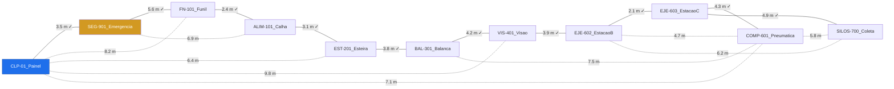

# Aula 19: Árvore Geradora Mínima (Algoritmos de Kruskal e Prim) — Projeto de Rede de Cabeamento Industrial SCADA

**Projeto:** SCADA-Core Automática — GRUPO 4  
**Unidade Fabril:** Linha Automatizada de Seleção, Pesagem Dinâmica e Classificação Óptica de Grãos com Separação Pneumática Tripla  
**Referência Normativa:** ISA-5.1, IEC 61158 (Redes Industriais) & Teoria dos Grafos e Árvores Aplicada à Automação  

---

## 1. Situação-Problema na Planta Industrial

Nas etapas anteriores (Aulas 11 a 18), modelamos o fluxo físico de grãos, a circulação de veículos e as rotas de inspeção da planta. Entretanto, para que o sistema **SCADA-Core Automática** opere na prática, todos os sensores, atuadores, inversores, câmera industrial e painéis de segurança precisam estar fisicamente interligados ao **Painel Central do CLP (`CLP-01_Painel`)** por meio de eletrocalhas e cabeamento industrial blindado (barramento de campo / Ethernet Industrial).

Na planta de classificação de grãos, existem **11 nós de automação** distribuídos ao longo da linha de produção e **19 trechos viáveis de eletrocalha** mapeados na arquitetura do galpão (totalizando $100{,}4\text{ m}$ caso todas as interligações possíveis fossem instaladas).

O problema de engenharia consiste em:
1. **Conectar todos os 11 equipamentos** à rede do SCADA sem deixar nenhum nó isolado (grafo conexo);
2. **Eliminar ciclos físicos** na topologia lógica de cabeamento (evitando *broadcast storms* em redes Ethernet sem STP, loops de aterramento e desperdício de material);
3. **Minimizar o comprimento total de cabeamento** (e, consequentemente, o custo de eletrocalhas, cabos blindados e mão de obra);
4. **Avaliar contingência ($N-1$):** identificar o impacto de um eventual rompimento de cabo e determinar a **Segunda Melhor Árvore Geradora** para planejamento de anel de redundância.

> **Diferença fundamental em relação ao Dijkstra (Aula 14):**  
> O algoritmo de **Dijkstra** encontra o menor caminho a partir de uma origem até cada destino individualmente (árvore de caminhos mínimos). Já a **Árvore Geradora Mínima (MST)** minimiza a **soma total das arestas** necessárias para manter toda a rede conectada simultaneamente.

---

## 2. Fundamentos Matemáticos: Árvores e Árvore Geradora Mínima (MST)

### 2.1. Definição de Árvore e Árvore Geradora

Um grafo não-dirigido $T = (V, E_T)$ é uma **árvore** se for **conexo** e **acíclico**. Para qualquer árvore com $|V|$ vértices, valem as propriedades equivalentes:
* $|E_T| = |V| - 1$;
* Existe **exatamente um** caminho simples entre qualquer par de vértices $u, v \in V$;
* A remoção de qualquer aresta desconecta $T$ (toda aresta é uma **ponte**);
* A adição de qualquer nova aresta entre vértices de $V$ cria **exatamente um ciclo**.

Dado um grafo conexo, não-dirigido e ponderado $G = (V, E, w)$ com $w: E \to \mathbb{R}_{\ge 0}$, uma **Árvore Geradora (*Spanning Tree*)** é um subgrafo $T = (V, E_T)$ que contém todos os vértices de $G$ e é uma árvore. A **Árvore Geradora Mínima (*Minimum Spanning Tree* — MST)** é uma árvore geradora que minimiza o peso total:

$$w(T) = \sum_{e \in E_T} w(e)$$

### 2.2. Propriedade do Corte e Propriedade do Ciclo

A correção dos algoritmos gulosos de Kruskal e Prim baseia-se em dois teoremas clássicos:

1. **Propriedade do Corte (*Cut Property*):**  
   Para qualquer partição $(S, V \setminus S)$ dos vértices de $G$, se uma aresta $e = (u, v)$ com $u \in S$ e $v \in V \setminus S$ tiver o **menor peso estrito** dentre todas as arestas que cruzam o corte, então $e$ pertence necessariamente a toda MST de $G$.
2. **Propriedade do Ciclo (*Cycle Property*):**  
   Para qualquer ciclo $C$ em $G$, a aresta de **maior peso estrito** em $C$ não pode pertencer a nenhuma MST de $G$.

> **Unicidade:** Quando todos os pesos das arestas de $G$ são distintos entre si, a MST é **única**.

---

## 3. Os Algoritmos de Kruskal e Prim

### 3.1. Algoritmo de Kruskal (1956) — Estratégia Global por Arestas

O algoritmo de **Kruskal** ordena todas as arestas do grafo em ordem crescente de peso e as adiciona à árvore $T$ uma a uma, **desde que não formem ciclo** com as arestas já selecionadas.

* **Estrutura de dados:** **Union-Find (*Disjoint Set Union* — DSU)** com *path compression* e *union by rank*, permitindo verificar se dois vértices pertencem à mesma componente conexa em tempo quase constante $O(\alpha(|V|))$.
* **Complexidade computacional:**
  $$O(|E| \log |E|)$$
* **Indicação:** Ideal para grafos **esparsos** ($|E| \approx |V|$) ou quando a lista de trechos candidatos já está disponível globalmente para orçamento de engenharia.

### 3.2. Algoritmo de Prim (1957) — Estratégia Local por Vértices

O algoritmo de **Prim** inicia a partir de um **vértice raiz** $r \in V$ (no nosso caso, o painel central `CLP-01_Painel`) e expande a árvore $T$ passo a passo, escolhendo sempre a aresta de **menor peso** que conecta um vértice já incluído em $T$ a um vértice ainda fora de $T$.

* **Estrutura de dados:** **Fila de Prioridade (*Min-Heap*)** armazenando arestas candidatas da fronteira.
* **Complexidade computacional:**
  $$O((|V| + |E|) \log |V|)$$
* **Indicação:** Ideal para grafos **densos** ou quando a rede cresce organicamente a partir de um concentrador central (CLP/Switch).

### 3.3. Comparação Kruskal vs. Prim

| Critério | Algoritmo de Kruskal | Algoritmo de Prim |
| :--- | :--- | :--- |
| **Unidade de decisão** | Arestas (ordenadas globalmente) | Vértices (fronteira a partir da raiz) |
| **Estrutura auxiliar** | Union-Find (DSU) | Min-Heap (`heapq`) |
| **Complexidade** | $O(|E| \log |E|)$ | $O((|V| + |E|) \log |V|)$ |
| **Estado intermediário** | Floresta de subárvores desconexas | Uma única árvore conexa crescente |
| **Melhor cenário** | Grafos esparsos | Grafos densos ou expansão a partir de um nó central |

---

## 4. Modelagem da Rede SCADA-Core da Planta (Grupo 4)

### 4.1. Vértices ($|V| = 11$ Nós de Automação)

| Nó | Descrição Física | Tags ISA 5.1 Associadas |
| :--- | :--- | :--- |
| `CLP-01_Painel` | Painel Central de Controle e Supervisão | `c_PERM`, `SCADA-Core` |
| `SEG-901_Emergencia` | Botoeira e Relé de Segurança | `XA-901` (`p_EMERG`) |
| `FN-101_Funil` | Funil de Recepção de Grãos | `LIT-101` (`p_NB101`, `p_NA101`, `p_NC101`) |
| `ALIM-101_Calha` | Alimentador Vibratório Dosador | `c_ALIM` (Driver PWM) |
| `EST-201_Esteira` | Motor de Tração e Encoder da Esteira | `c_EST`, `ST-201`, `JI-201` |
| `BAL-301_Balanca` | Mesa de Pesagem Contínua | `WT-301`, `FT-301` |
| `VIS-401_Visao` | Túnel de Visão Computacional | `XS-401`, `KSA-401`, `CV-101`..`CV-109` |
| `EJE-602_EstacaoB` | Estação de Ejeção Pneumática B | `FY-602`, `ZSH-602`, `ZC-602` |
| `EJE-603_EstacaoC` | Estação de Ejeção Pneumática C | `FY-603`, `ZSH-601`, `ZC-603` |
| `COMP-601_Pneumatica` | Central de Ar Comprimido | `PT-601`, `PAL-601` |
| `SILOS-700_Coleta` | Concentrador dos Silos A, B e C | `LIT-701`, `LIT-702`, `LIT-703` |

### 4.2. Topologia Candidata e Arestas Selecionadas na MST (Mermaid)

No diagrama abaixo, as **linhas sólidas destacadas** representam as $10$ arestas selecionadas pela MST ($37{,}8\text{ m}$), enquanto as **linhas tracejadas** representam as $9$ rotas redundantes descartadas por formarem ciclos de maior custo:

---

## 5. Resolução Analítica Passo a Passo

### 5.1. Execução pelo Algoritmo de Kruskal (Ordenação Global)

Ordenando as $19$ arestas por comprimento crescente, o algoritmo aceita exatamente $|V|-1 = 10$ arestas e rejeita aquelas que fecham ciclos:

| Passo | Aresta Candidata | Peso (m) | Ação (Union-Find) | Custo Acumulado (m) |
| :---: | :--- | :---: | :--- | :---: |
| 1 | `EJE-602_EstacaoB` — `EJE-603_EstacaoC` | 2,1 | **Aceita** (une {EJE-602, EJE-603}) | 2,1 |
| 2 | `FN-101_Funil` — `ALIM-101_Calha` | 2,4 | **Aceita** (une {FN-101, ALIM-101}) | 4,5 |
| 3 | `ALIM-101_Calha` — `EST-201_Esteira` | 3,1 | **Aceita** (une ao grupo do Funil) | 7,6 |
| 4 | `CLP-01_Painel` — `SEG-901_Emergencia` | 3,5 | **Aceita** (une {CLP-01, SEG-901}) | 11,1 |
| 5 | `EST-201_Esteira` — `BAL-301_Balanca` | 3,8 | **Aceita** | 14,9 |
| 6 | `VIS-401_Visao` — `EJE-602_EstacaoB` | 3,9 | **Aceita** | 18,8 |
| 7 | `BAL-301_Balanca` — `VIS-401_Visao` | 4,2 | **Aceita** (conecta tronco até ejetores) | 23,0 |
| 8 | `EJE-603_EstacaoC` — `COMP-601_Pneumatica` | 4,3 | **Aceita** | 27,3 |
| — | `EJE-602_EstacaoB` — `COMP-601_Pneumatica` | 4,7 | *Rejeitada* (forma ciclo com EJE-603 e COMP-601) | 27,3 |
| 9 | `EJE-603_EstacaoC` — `SILOS-700_Coleta` | 4,9 | **Aceita** | 32,2 |
| 10 | `SEG-901_Emergencia` — `FN-101_Funil` | 5,6 | **Aceita** (atinge $10$ arestas — MST completa!) | **37,8** |

### 5.2. Execução pelo Algoritmo de Prim (Raiz = `CLP-01_Painel`)

Partindo do `CLP-01_Painel`, a fronteira cresce sempre pela menor aresta que alcança um nó ainda não visitado:

1. `CLP-01_Painel` $\to$ `SEG-901_Emergencia` ($3{,}5\text{ m}$)
2. `SEG-901_Emergencia` $\to$ `FN-101_Funil` ($5{,}6\text{ m}$) — *(menor que $6{,}4\text{ m}$ para `EST-201`)*
3. `FN-101_Funil` $\to$ `ALIM-101_Calha` ($2{,}4\text{ m}$)
4. `ALIM-101_Calha` $\to$ `EST-201_Esteira` ($3{,}1\text{ m}$)
5. `EST-201_Esteira` $\to$ `BAL-301_Balanca` ($3{,}8\text{ m}$)
6. `BAL-301_Balanca` $\to$ `VIS-401_Visao` ($4{,}2\text{ m}$)
7. `VIS-401_Visao` $\to$ `EJE-602_EstacaoB` ($3{,}9\text{ m}$)
8. `EJE-602_EstacaoB` $\to$ `EJE-603_EstacaoC` ($2{,}1\text{ m}$)
9. `EJE-603_EstacaoC` $\to$ `COMP-601_Pneumatica` ($4{,}3\text{ m}$)
10. `EJE-603_EstacaoC` $\to$ `SILOS-700_Coleta` ($4{,}9\text{ m}$)

**Resultado Idêntico:** Ambos os algoritmos convergem exatamente para as mesmas $10$ arestas e custo total mínimo de **$37{,}8\text{ m}$**, representando uma **economia de $62{,}6\text{ m}$ ($62{,}35\%$)** em relação à instalação de todos os trechos candidatos ($100{,}4\text{ m}$).

### 5.3. Análise de Contingência ($N-1$) e Segunda Melhor MST

Se houver rompimento do cabo `EJE-603_EstacaoC` — `COMP-601_Pneumatica` ($4{,}3\text{ m}$), a rede se divide em duas componentes conexas, isolando a central pneumática (`PAL-601`/`PT-601`). A aresta de menor peso que atravessa o corte para restabelecer a árvore é `EJE-602_EstacaoB` — `COMP-601_Pneumatica` ($4{,}7\text{ m}$), gerando a **Segunda Melhor Árvore Geradora** com custo **$38{,}2\text{ m}$** (acréscimo de apenas $+0{,}4\text{ m}$). Essa análise orienta o projeto de um enlace de redundância para protocolos industriais como **MRP/RSTP**.

---

## 6. Validação Computacional

A implementação completa em Python com `UnionFind`, `kruskal_mst`, `prim_mst`, verificação de equivalência, simulação de falhas $N-1$ e cálculo da Segunda Melhor MST encontra-se no notebook:

* [19 - Arvore Geradora Minima (Kruskal e Prim).ipynb](./19%20-%20Arvore%20Geradora%20Minima%20(Kruskal%20e%20Prim).ipynb)
