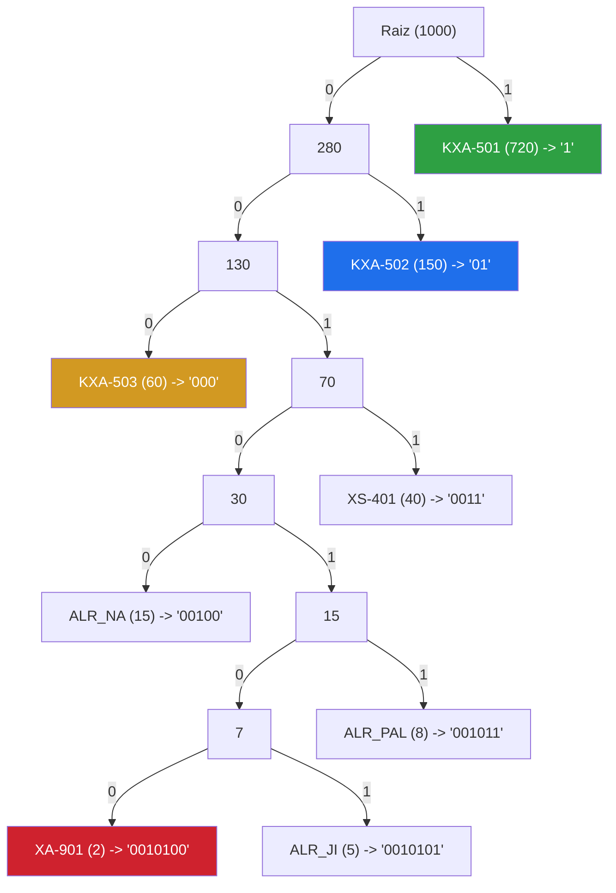

# Aula 20: Codificação de Huffman — Compressão Sem Perdas de Telemetria e Eventos do SCADA-Core

**Projeto:** SCADA-Core Automática — GRUPO 4  
**Unidade Fabril:** Linha Automatizada de Seleção, Pesagem Dinâmica e Classificação Óptica de Grãos com Separação Pneumática Tripla  
**Referência Normativa:** ISA-5.1, ISA-18.2 (Gestão de Alarmes) & Teoria da Informação e Árvores Binárias  

---

## 1. Situação-Problema na Planta Industrial

Na linha de classificação óptica de grãos do Grupo 4, a esteira opera em alta velocidade ($1\text{ a }2\text{ m/s}$), fazendo com que o sensor fotoelétrico **XS-401** dispare a câmera industrial (**KSA-401**) dezenas de vezes por segundo. A cada grão inspecionado — e a cada evento de supervisão ou alarme — o CLP envia mensagens discretas para o **Historiador do SCADA (Nível 3)** e para o registrador de eventos **ISA-18.2**.

Em uma operação contínua (turnos de $8$ a $24$ horas), a distribuição estatística desses eventos é **fortemente assimétrica**:
* A grande maioria dos registros corresponde à aprovação nominal de grãos (**Categoria A — `KXA-501`**);
* Ocorrências secundárias (**Categoria B — `KXA-502`**) e rejeitos (**Categoria C — `KXA-503`**) aparecem com frequência intermediária;
* Alarmes críticos como baixa pressão pneumática (**`PAL-601`**), sobrecarga do motor (**`JI-201`**) e parada de emergência (**`XA-901`**) são eventos raros.

Armazenar ou transmitir cada símbolo usando **codificação de largura fixa** (ex.: $3\text{ bits}$ para $8$ símbolos, ou $8\text{ bits}$ por caractere em ASCII) desperdiça largura de banda do barramento de campo e espaço no banco histórico do SCADA.

A **Codificação de Huffman** resolve esse gargalo gerando uma **árvore binária ótima de prefixos** que atribui **códigos binários curtos aos eventos mais frequentes** e códigos mais longos aos eventos raros, garantindo **compressão 100% sem perdas (*lossless*)** e **decodificação instantânea**.

---

## 2. Fundamentos Matemáticos: Árvores de Prefixos, Entropia e Algoritmo de Huffman

### 2.1. Códigos de Prefixo (*Prefix-Free Codes*)

Seja um alfabeto finito de símbolos $\Sigma = \{s_1, s_2, \dots, s_k\}$ com probabilidades de ocorrência $p_1, p_2, \dots, p_k$ ($\sum_{i=1}^{k} p_i = 1$). Uma codificação binária $C: \Sigma \to \{0, 1\}^+$ é um **código de prefixo** se nenhuma palavra-código $C(s_i)$ for prefixo de outra palavra-código $C(s_j)$ ($i \ne j$).

* **Representação em Árvore Binária:**  
  Todo código de prefixo corresponde a uma **árvore binária cheia** (*full binary tree*, onde todo nó interno possui exatamente 2 filhos):
  * Os ramos à esquerda recebem o bit **`0`** e os ramos à direita recebem o bit **`1`**;
  * Apenas as **folhas** representam símbolos de $\Sigma$ (como nenhuma folha é ancestral de outra folha, a propriedade de prefixo é garantida estruturalmente);
  * O comprimento $l_i = |C(s_i)|$ da palavra-código é exatamente a **profundidade** da folha $s_i$ na árvore.

Isso garante que um fluxo contínuo de bits (*bitstream*) seja decodificado de forma **única e sem delimitadores** em tempo linear $O(\text{tamanho do bitstream})$.

### 2.2. Entropia de Shannon e Comprimento Médio

Pelo Primeiro Teorema de Shannon (Teorema da Codificação Sem Ruído), o limite teórico inferior para o número médio de bits por símbolo em qualquer compressão sem perdas é dado pela **Entropia de Shannon**:

$$H(X) = -\sum_{i=1}^{k} p_i \log_2(p_i) \quad [\text{bits/símbolo}]$$

O **comprimento médio esperado** de um código de prefixo $C$ é:

$$L_{\text{médio}}(C) = \sum_{i=1}^{k} p_i \cdot l_i$$

Para a codificação ótima de Huffman, vale sempre a cota fundamental:

$$H(X) \le L_{\text{médio}}(C_{\text{Huffman}}) < H(X) + 1$$

A **eficiência informacional** do código é medida por:

$$\eta = \frac{H(X)}{L_{\text{médio}}} \times 100\%$$

### 2.3. Algoritmo de Huffman (1952)

O algoritmo constrói a árvore binária ótima de forma **gulosa e *bottom-up*** utilizando uma **Fila de Prioridade (*Min-Heap*)**:

1. Crie um nó folha para cada símbolo $s_i \in \Sigma$ com peso igual à sua frequência $f_i$ e insira todos no *Min-Heap*;
2. Enquanto houver mais de um nó no *Min-Heap*:
   * Extraia os dois nós de **menor frequência**, $u$ e $v$;
   * Crie um novo nó interno $z$ com filhos $u$ (ramo `0`) e $v$ (ramo `1`) e frequência $f(z) = f(u) + f(v)$;
   * Insira $z$ de volta no *Min-Heap*;
3. O único nó restante é a **raiz** da Árvore de Huffman ótima.

* **Complexidade computacional:** $O(k \log k)$, onde $k = |\Sigma|$ é o tamanho do alfabeto (desprezível para o CLP/SCADA).

---

## 3. Aplicação na Planta SCADA-Core (Grupo 4)

### 3.1. Alfabeto de Eventos e Telemetria da Planta

Considerando um lote padrão de $1\,000$ eventos discretos registrados pelo Historiador do SCADA durante a operação nominal da linha de beneficiamento de arroz:

| Símbolo / Tag ISA 5.1 | Descrição Operacional na Planta | Frequência ($f_i$) | Probabilidade ($p_i$) | Código Fixo (3 bits) | Código Huffman | Comprimento ($l_i$) |
| :--- | :--- | :---: | :---: | :---: | :--- | :---: |
| **`KXA-501 (Cat. A)`** | Grão aprovado — segue ao `SILO-701` | 720 | 0,720 | `000` | `1` | **1 bit** |
| **`KXA-502 (Cat. B)`** | Grão secundário — ejeção `FY-602` $\to$ `SILO-702` | 150 | 0,150 | `001` | `01` | **2 bits** |
| **`KXA-503 (Cat. C)`** | Grão rejeitado — ejeção `FY-603` $\to$ `SILO-703` | 60 | 0,060 | `010` | `000` | **3 bits** |
| **`XS-401 (Sync)`** | Pulso de sincronismo / *heartbeat* da câmera | 40 | 0,040 | `011` | `0011` | **4 bits** |
| **`ALR_NA (Silo)`** | Aviso de nível alto nos silos (`p_NA701..703`) | 15 | 0,015 | `100` | `00100` | **5 bits** |
| **`ALR_PAL (Ar)`** | Alarme de baixa pressão pneumática (`PAL-601`) | 8 | 0,008 | `101` | `001011` | **6 bits** |
| **`ALR_JI (Motor)`** | Alarme de sobrecarga no motor (`JI-201`) | 5 | 0,005 | `110` | `0010101` | **7 bits** |
| **`XA-901 (Emerg)`** | Acionamento da botoeira de emergência (`p_EMERG`) | 2 | 0,002 | `111` | `0010100` | **7 bits** |

### 3.2. Árvore Binária de Huffman Gerada (Mermaid)

Na árvore abaixo, cada ramo esquerdo representa o bit `0` e cada ramo direito representa o bit `1`:

---

## 4. Resolução Analítica e Métricas de Desempenho

1. **Comprimento em Codificação Fixa:**  
   Como $|\Sigma| = 8$, são necessários $\lceil \log_2(8) \rceil = \mathbf{3{,}0000\text{ bits/símbolo}}$ ($3\,000$ bits para $1\,000$ eventos).

2. **Comprimento Médio com Huffman:**
   $$L_{\text{médio}} = 0{,}720(1) + 0{,}150(2) + 0{,}060(3) + 0{,}040(4) + 0{,}015(5) + 0{,}008(6) + 0{,}005(7) + 0{,}002(7)$$
   $$L_{\text{médio}} = 0{,}720 + 0{,}300 + 0{,}180 + 0{,}160 + 0{,}075 + 0{,}048 + 0{,}035 + 0{,}014 = \mathbf{1{,}5320\text{ bits/símbolo}}$$
   Para $1\,000$ eventos, o volume cai de $3\,000\text{ bits}$ para **$1\,532\text{ bits}$**.

3. **Entropia de Shannon:**
   $$H(X) = -\sum_{i=1}^{8} p_i \log_2(p_i) = \mathbf{1{,}3838\text{ bits/símbolo}}$$

4. **Economia de Banda e Eficiência:**
   * **Economia frente ao código fixo de 3 bits:** $\left(1 - \frac{1{,}5320}{3}\right) \times 100\% = \mathbf{48{,}93\%}$
   * **Eficiência informacional ($\eta = H(X)/L_{\text{médio}}$):** $\mathbf{90{,}33\%}$
   * **Comparação com texto ASCII (8 bits/caractere):** considerando identificadores de ~12 caracteres por evento ($96\text{ bits}$), a economia ultrapassa **$98\%$** para o historiador do SCADA.

---

## 5. Validação Computacional

A implementação completa da Árvore de Huffman em Python — incluindo construção via `heapq`, geração da tabela de prefixos, **codificação e decodificação 100% sem perdas** de um fluxo simulado de $1\,000$ eventos do SCADA e também de **logs textuais de alarmes ISA-18.2** — encontra-se no notebook:

* [20 - Codificacao de Huffman.ipynb](./20%20-%20Codificacao%20de%20Huffman.ipynb)
