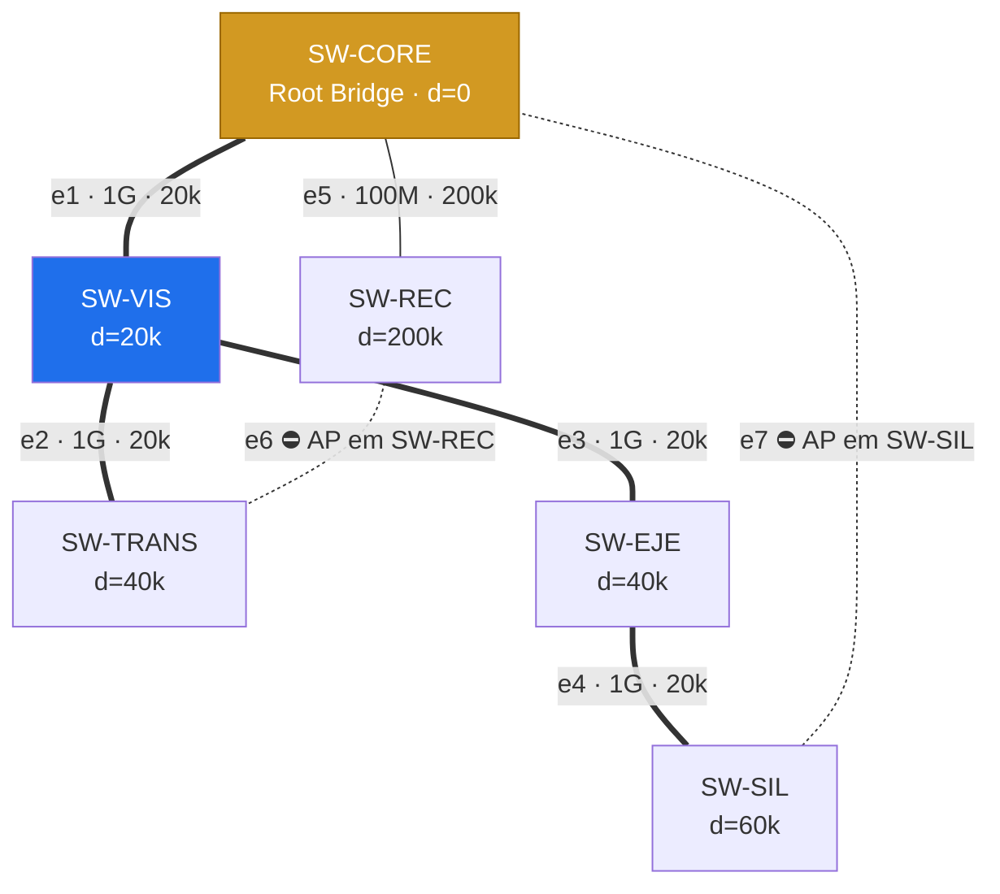
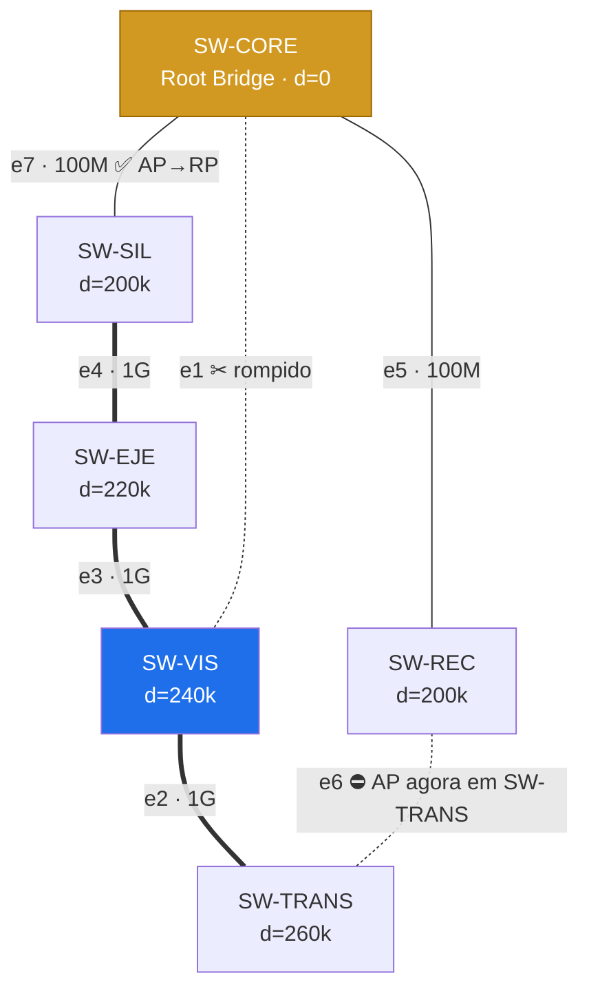

# Aula 23: Protocolo de Árvore Geradora (STP / RSTP) — Redundância da Rede Ethernet do SCADA-Core

**Projeto:** SCADA-Core Automática — GRUPO 4  
**Unidade Fabril:** Linha Automatizada de Seleção, Pesagem Dinâmica e Classificação Óptica de Grãos com Separação Pneumática Tripla  
**Referência Normativa:** IEEE 802.1D (STP), IEEE 802.1w (RSTP), IEC 61158 (Redes Industriais) & Teoria dos Grafos e Árvores Aplicada à Automação  

---

## 1. Situação-Problema na Planta Industrial

Na Aula 19, a Árvore Geradora Mínima definiu o **cabeamento mais curto** que liga os 11 nós de automação ao `CLP-01_Painel`. Uma árvore, porém, tem um defeito operacional: **toda aresta é uma ponte**. Se um único cabo romper, parte da planta some do supervisório. Na própria análise $N-1$ da Aula 19, o rompimento de `EJE-603_EstacaoC` — `COMP-601_Pneumatica` isolava a central de ar comprimido.

A solução de engenharia é instalar **enlaces redundantes** entre os switches de cada zona da linha, formando um anel com uma corda. Isso cria um novo problema: o grafo físico passa a ter **ciclos**, e uma rede Ethernet com ciclos não funciona sozinha.

O problema desta aula consiste em:
1. **Manter o grafo físico com ciclos** (redundância para tolerar o rompimento de qualquer cabo);
2. **Ativar logicamente apenas uma árvore geradora** desse grafo, bloqueando os enlaces que fecham ciclos;
3. **Escolher essa árvore de forma determinística**, com raiz no painel do CLP e menor custo de caminho até ela;
4. **Recalcular a árvore em menos de 1 s** quando um cabo romper, antes que o CLP perca a comunicação com a câmera e derrube a planta pelo permissivo `c_PERM`.

> **Diferença fundamental em relação à Aula 19:**  
> Na Aula 19 o grafo era o **projeto** do cabeamento: a MST dizia quais trechos instalar. Aqui todos os enlaces já estão instalados, e a árvore é calculada **em tempo de operação** pelos próprios switches, de forma distribuída, trocando mensagens (BPDUs). A árvore lógica muda sempre que o grafo físico muda.

---

## 2. Fundamentos: Por Que Ciclos Derrubam uma Rede Ethernet

### 2.1. Ausência de TTL na Camada 2

Um pacote IP (camada 3) carrega o campo **TTL** (*Time-To-Live*), decrementado a cada roteador; quando chega a zero, o pacote é descartado. O quadro Ethernet (IEEE 802.3, camada 2) **não tem esse campo**. Um switch que recebe um quadro de *broadcast* (ex.: requisição ARP, descoberta de dispositivos PROFINET) o replica em **todas as portas**, exceto a de entrada.

Seja $C_k = (v_1, v_2, \dots, v_k, v_1)$ um ciclo no grafo dos switches. Um único broadcast emitido em $v_1$ percorre o ciclo nos dois sentidos e volta a $v_1$, que o replica de novo, indefinidamente. Em cada vértice de grau $d(v) \ge 3$ o quadro ainda é multiplicado por $d(v) - 1$. O número de cópias cresce sem limite, gerando:

1. **Tempestade de *broadcast*:** a banda dos enlaces satura em segundos e os quadros cíclicos do CLP (leituras de `WT-301`, `ST-201`, comandos `FY-602`/`FY-603`) deixam de chegar no prazo;
2. **Instabilidade da tabela MAC (*MAC flapping*):** o switch aprende o mesmo endereço MAC (ex.: o do `CLP-01`) alternadamente em portas diferentes e passa a encaminhar quadros para o lado errado.

### 2.2. Árvore Geradora como Solução

Pela propriedade vista na Aula 19, uma árvore $T = (V, E_T)$ tem **exatamente um caminho simples** entre quaisquer dois vértices. Se apenas as arestas de $E_T$ encaminharem quadros, nenhum broadcast consegue voltar ao ponto de origem. As arestas de $E \setminus E_T$ não são desligadas: ficam **bloqueadas logicamente** (estado *Discarding*), em espera para substituir uma aresta da árvore que falhar.

$$|E_T| = |V| - 1 \qquad\qquad |E \setminus E_T| = |E| - |V| + 1$$

O número de enlaces bloqueados, $|E| - |V| + 1$, é o **número ciclomático** do grafo: a quantidade de ciclos independentes que precisam ser abertos.

---

## 3. Modelagem da Rede de Switches da Planta (Grupo 4)

Os 11 nós da Aula 19 são agrupados em **6 zonas**, cada uma atendida por um switch industrial gerenciável. Os equipamentos de campo ligam-se ao switch da sua zona por portas de borda (*edge ports*) e não participam da árvore; os vértices do grafo são apenas os switches.

### 3.1. Vértices ($|V| = 6$ Switches)

| Switch | Zona da Linha | Equipamentos Atendidos (Aula 19) | Bridge Priority | MAC (base do Bridge ID) |
| :--- | :--- | :--- | :---: | :--- |
| `SW-CORE` | Painel central e supervisão | `CLP-01_Painel`, IHM do `SCADA-Core`, `SEG-901_Emergencia` (somente status) | **4096** | `00:1A:2B:00:00:01` |
| `SW-REC` | Recepção e dosagem | `FN-101_Funil`, `ALIM-101_Calha` | 32768 | `00:1A:2B:00:00:02` |
| `SW-TRANS` | Transporte e pesagem | `EST-201_Esteira`, `BAL-301_Balanca` | 32768 | `00:1A:2B:00:00:03` |
| `SW-VIS` | Classificação óptica | `VIS-401_Visao` (câmera industrial) | **8192** | `00:1A:2B:00:00:04` |
| `SW-EJE` | Ejeção e pneumática | `EJE-602_EstacaoB`, `EJE-603_EstacaoC`, `COMP-601_Pneumatica` | 32768 | `00:1A:2B:00:00:05` |
| `SW-SIL` | Silos | `SILOS-700_Coleta` | 32768 | `00:1A:2B:00:00:06` |

O **Bridge ID** de cada switch é o par $\text{BID}(v) = (\text{prioridade}, \text{MAC})$, comparado em **ordem lexicográfica**: primeiro a prioridade e, em caso de empate, o MAC.

### 3.2. Arestas ($|E| = 7$ Enlaces Físicos) e Função de Peso

O peso $w(e)$ de cada enlace é o **custo de caminho** (*path cost*) padrão da IEEE 802.1w, inversamente proporcional à velocidade:

| Velocidade | Custo $w(e)$ | Uso na planta |
| :--- | :---: | :--- |
| $100\text{ Mbps}$ (Fast Ethernet, cobre blindado) | $200.000$ | Zonas com apenas sensores e atuadores (dados cíclicos pequenos) |
| $1\text{ Gbps}$ (Gigabit, fibra óptica) | $20.000$ | Tronco da câmera: imagens do `VIS-401` e comandos rápidos aos ejetores |

| Aresta | Enlace | Velocidade | $w(e)$ |
| :---: | :--- | :---: | :---: |
| $e_1$ | `SW-CORE` — `SW-VIS` | 1 Gbps | 20.000 |
| $e_2$ | `SW-VIS` — `SW-TRANS` | 1 Gbps | 20.000 |
| $e_3$ | `SW-VIS` — `SW-EJE` | 1 Gbps | 20.000 |
| $e_4$ | `SW-EJE` — `SW-SIL` | 1 Gbps | 20.000 |
| $e_5$ | `SW-CORE` — `SW-REC` | 100 Mbps | 200.000 |
| $e_6$ | `SW-REC` — `SW-TRANS` | 100 Mbps | 200.000 |
| $e_7$ | `SW-SIL` — `SW-CORE` | 100 Mbps | 200.000 |

O grafo físico é o anel `SW-CORE` → `SW-REC` → `SW-TRANS` → `SW-VIS` → `SW-EJE` → `SW-SIL` → `SW-CORE`, mais a corda de fibra $e_1$ que leva a câmera direto ao painel. Número ciclomático: $7 - 6 + 1 = 2$, ou seja, **2 enlaces precisarão ser bloqueados**.

---

## 4. O Algoritmo do RSTP

Cada switch troca **BPDUs** (*Bridge Protocol Data Units*) com os vizinhos. O conteúdo relevante de um BPDU é o **vetor de prioridade**:

$$\big(\ \text{Root BID},\ \text{Root Path Cost},\ \text{BID do remetente},\ \text{Port ID do remetente}\ \big)$$

Dois vetores são comparados em **ordem lexicográfica**: vence o menor no primeiro campo; havendo empate, o menor no segundo, e assim por diante. Com essa única regra de comparação, a rede converge em três passos.

### 4.1. Passo 1 — Eleição do Root Bridge

$$v_{\text{root}} = \arg\min_{v \in V} \text{BID}(v)$$

Se todos os switches ficassem com a prioridade de fábrica ($32768$), a raiz seria o de menor MAC, uma escolha arbitrária. Por isso as prioridades são **configuradas**:
* **`SW-CORE` (4096): Root primário.** O CLP e o SCADA estão nele; todo caminho mínimo deve terminar no painel.
* **`SW-VIS` (8192): Root secundário.** Se `SW-CORE` sair do ar, a raiz passa para o centro do tronco de fibra, e não para um switch de 100 Mbps qualquer.

### 4.2. Passo 2 — Root Path Cost e Root Port

Cada switch $v$ calcula o menor custo acumulado até a raiz, $d(v)$, e escolhe como **Root Port (RP)** a porta por onde esse custo é alcançado:

$$d(v_{\text{root}}) = 0, \qquad d(v) = \min_{u \in N(v)} \big( d(u) + w(u, v) \big)$$

Essa é exatamente a recorrência do **Dijkstra (Aula 14)** com origem na raiz. O RSTP a resolve de forma distribuída: cada switch só conhece o que os vizinhos anunciam nos BPDUs. Desempate entre caminhos de mesmo custo: menor BID do vizinho, depois menor Port ID.

| Switch | Candidatos $d(u) + w(u,v)$ | $d(v)$ | Root Port aponta para |
| :--- | :--- | :---: | :--- |
| `SW-CORE` | — (raiz) | **0** | — |
| `SW-VIS` | via CORE: $0 + 20.000$ · via TRANS: $40.000 + 20.000$ · via EJE: $40.000 + 20.000$ | **20.000** | `SW-CORE` |
| `SW-TRANS` | via VIS: $20.000 + 20.000$ · via REC: $200.000 + 200.000$ | **40.000** | `SW-VIS` |
| `SW-EJE` | via VIS: $20.000 + 20.000$ · via SIL: $60.000 + 20.000$ | **40.000** | `SW-VIS` |
| `SW-SIL` | via EJE: $40.000 + 20.000$ · via CORE: $0 + 200.000$ | **60.000** | `SW-EJE` |
| `SW-REC` | via CORE: $0 + 200.000$ · via TRANS: $40.000 + 200.000$ | **200.000** | `SW-CORE` |

> O `SW-SIL` está ligado **diretamente** ao painel, mas prefere chegar à raiz por três saltos de fibra ($60.000$) em vez de um salto de cobre ($200.000$). O critério é custo, não número de saltos.

### 4.3. Passo 3 — Designated Port e Alternate Port

Em cada enlace (segmento), a extremidade cujo switch anuncia o **menor vetor** (menor $d$, depois menor BID) torna-se a **Designated Port (DP)**: é ela que encaminha quadros naquele segmento. A outra extremidade é a **Root Port** do vizinho ou, se não for, vira **Alternate Port (AP)**, no estado *Discarding*.

| Enlace | Extremidade A | Extremidade B | Estado do enlace |
| :--- | :--- | :--- | :--- |
| $e_1$ CORE — VIS | `SW-CORE`: **DP** | `SW-VIS`: **RP** | ✅ Forwarding |
| $e_2$ VIS — TRANS | `SW-VIS`: **DP** | `SW-TRANS`: **RP** | ✅ Forwarding |
| $e_3$ VIS — EJE | `SW-VIS`: **DP** | `SW-EJE`: **RP** | ✅ Forwarding |
| $e_4$ EJE — SIL | `SW-EJE`: **DP** | `SW-SIL`: **RP** | ✅ Forwarding |
| $e_5$ CORE — REC | `SW-CORE`: **DP** | `SW-REC`: **RP** | ✅ Forwarding |
| $e_6$ REC — TRANS | `SW-REC` ($d = 200.000$): **AP** | `SW-TRANS` ($d = 40.000$): **DP** | ⛔ Bloqueado |
| $e_7$ SIL — CORE | `SW-SIL` ($d = 60.000$): **AP** | `SW-CORE` ($d = 0$): **DP** | ⛔ Bloqueado |

**Resultado:** $|E_T| = 5 = |V| - 1$ enlaces ativos e $2$ bloqueados, igual ao número ciclomático. Cada switch não raiz tem exatamente uma Root Port, ou seja, exatamente um "pai" na árvore.

---

## 5. Árvore do RSTP × Árvore Geradora Mínima

É comum dizer que o STP "calcula uma MST", mas isso não é exato. As duas árvores minimizam coisas diferentes:

| | MST (Kruskal / Prim, Aula 19) | Árvore do RSTP |
| :--- | :--- | :--- |
| **Minimiza** | Soma dos pesos das arestas: $\sum_{e \in E_T} w(e)$ | Distância de **cada** vértice à raiz: $d(v)$ para todo $v$ |
| **Depende da raiz?** | Não | Sim |
| **Algoritmo equivalente** | Kruskal / Prim | Dijkstra (árvore de caminhos mínimos) |
| **Pergunta que responde** | Qual cabeamento custa menos para instalar? | Por onde cada switch fala com o painel? |

**Contraexemplo mínimo.** Raiz $R$ e arestas $R$—$A$ ($2$), $A$—$B$ ($2$), $R$—$B$ ($3$). A MST é $\{R\text{–}A, A\text{–}B\}$, com peso $4$, mas nela $d(B) = 4$. O RSTP escolhe $\{R\text{–}A, R\text{–}B\}$, com peso $5$ (maior), porque nela $d(B) = 3$ (menor).

**Na nossa planta, após o rompimento de $e_1$ (Seção 6),** as duas árvores têm o **mesmo peso total**, $460.000$, mas são **diferentes**. O Kruskal pode devolver a árvore que usa $e_6$ (REC — TRANS), na qual a câmera fica a $d(\text{SW-VIS}) = 420.000$ do painel. O RSTP escolhe a que usa $e_7$ (SIL — CORE), com $d(\text{SW-VIS}) = 240.000$. Com o mesmo custo total, a distância da câmera até o painel cai quase pela metade.

---

## 6. Simulação de Falha: Rompimento da Fibra da Câmera ($e_1$)

O enlace mais crítico da rede é $e_1$ (`SW-CORE` — `SW-VIS`): é por ele que o CLP recebe o estado da câmera (`p_KSA401`) e as classificações `CV-101`..`CV-109`. Considere seu rompimento físico.

### 6.1. Reconvergência

O `SW-VIS` detecta *link down* e perde sua Root Port. Os switches trocam BPDUs com o novo grafo $G' = G - e_1$ e recalculam:

| Switch | Novo $d(v)$ | Nova Root Port | Mudança |
| :--- | :---: | :--- | :--- |
| `SW-CORE` | 0 | — | — |
| `SW-REC` | 200.000 | `SW-CORE` | — |
| `SW-SIL` | **200.000** | **`SW-CORE`** (via $e_7$) | A Alternate Port vira Root Port e passa a encaminhar |
| `SW-EJE` | **220.000** | **`SW-SIL`** | A Root Port inverte de sentido |
| `SW-VIS` | **240.000** | **`SW-EJE`** | A câmera agora chega ao painel pelos silos |
| `SW-TRANS` | **260.000** | `SW-VIS` | — |

No enlace $e_6$ (REC — TRANS), agora $d(\text{SW-REC}) = 200.000 < d(\text{SW-TRANS}) = 260.000$: a Designated Port **troca de lado** e o bloqueio passa para a extremidade do `SW-TRANS`. A nova árvore ativa é $\{e_5, e_7, e_4, e_3, e_2\}$, novamente com $5$ arestas e um único bloqueio.

### 6.2. Consequência Operacional: Modo Degradado

* **Nada fica isolado:** a planta continua supervisionada, o que a MST pura da Aula 19 não garantia.
* **O caminho da câmera até o painel passa por um enlace de 100 Mbps** ($e_7$). Os dados cíclicos do CLP (bits de status, comandos de ejeção) são pequenos e continuam cabendo com folga. O **streaming de imagens** do `VIS-401` para a IHM, porém, deve ser reduzido (apenas imagens rejeitadas ou estatísticas) até a fibra ser reparada.
* O enlace $e_3$ (`SW-VIS` — `SW-EJE`) continua em fibra: a câmera e as estações de ejeção seguem vizinhas na árvore.
* O SCADA deve gerar um **alarme de manutenção** (enlace $e_1$ caído, rede sem redundância): uma segunda falha já pode isolar uma zona.

### 6.3. Falha do Próprio Root Bridge

Se `SW-CORE` falhar, o grafo restante é o caminho `SW-REC` — `SW-TRANS` — `SW-VIS` — `SW-EJE` — `SW-SIL`, que já é acíclico. O `SW-VIS` (prioridade 8192) assume como raiz e nenhuma porta fica bloqueada. Mas o `CLP-01` e o SCADA estão no switch que caiu: a rede de campo sobrevive, a supervisão não, e a planta vai para o estado seguro pela perda de comunicação. Redundância de rede **não substitui** redundância do controlador.

---

## 7. STP (802.1D) × RSTP (802.1w) na Nossa Linha

O tempo de reconvergência importa porque o permissivo da planta (Aula 2) depende do estado da câmera:

$$c_{\text{PERM}} \leftrightarrow \neg p_{\text{EMERG}} \land \neg p_{\text{JI201}} \land \neg p_{\text{PAL601}} \land p_{\text{KSA401}} \land \neg p_{\text{SILO\_CHEIO}}$$

Se o CLP ficar sem notícias do `VIS-401` por mais tempo que o seu *timeout* de comunicação, ele deve considerar $p_{\text{KSA401}} = 0$ e desligar a linha. Com a esteira na velocidade nominal de $v = 2{,}0\text{ m/s}$ (Aula 10, caso C01), cada segundo sem rede corresponde a $2\text{ m}$ de grãos que passam pelo túnel sem classificação confiável. Por isso o desarme vem logo após o *timeout*: a esteira anda no máximo $v \cdot t_{\text{timeout}}$ sem câmera, e o prejuízo passa a ser o **tempo de linha parada**, que com a vazão nominal de $1200\text{ kg/h}$ (Aula 12) custa $\approx 0{,}33\text{ kg}$ de arroz não processado por segundo.

| Critério | STP Clássico (IEEE 802.1D) | RSTP (IEEE 802.1w) — Adotado | Impacto na linha de grãos |
| :--- | :--- | :--- | :--- |
| **Reconvergência** | $30$ a $50\text{ s}$ | $< 1\text{ s}$ (tipicamente $50$ a $200\text{ ms}$ após *link down*) | STP: trip certo após o *timeout* ($\approx 1\text{ m}$ de esteira sem câmera) e linha parada por $30$ a $50\text{ s}$ ($10$ a $17\text{ kg}$ não processados). RSTP: no máximo $0{,}4\text{ m}$ sem câmera, abaixo do *timeout* do CLP: sem trip. |
| **Estados de porta** | 5 (*Disabled, Blocking, Listening, Learning, Forwarding*) | 3 (*Discarding, Learning, Forwarding*) | O RSTP elimina as esperas fixas de *Forward Delay* ($2 \times 15\text{ s}$). |
| **Papéis de porta** | *Root, Designated, Blocked* | *Root, Designated, **Alternate**, Backup* | A Alternate Port de `SW-SIL` já conhece um caminho para a raiz; vira Root Port sem esperar timers. |
| **Mecanismo de transição** | Temporizadores passivos | Negociação ativa *Proposal / Agreement* entre vizinhos | Cada enlace é liberado assim que os dois lados concordam. |

> **Requisito de projeto:** o *timeout* de comunicação do CLP com os nós de campo deve ser **maior** que o pior tempo de reconvergência do RSTP na rede (proposta: $500\text{ ms}$). Assim, o rompimento de um cabo gera um alarme, mas não um trip da planta.

---

## 8. Proteções de Borda

* **Edge Port (PortFast):** habilitada nas portas que ligam o `CLP-01`, a IHM, a câmera, as I/Os remotas das zonas e o ponto de acesso Wi-Fi do `AGV-01` (Aula 17). Essas portas entram direto em *Forwarding*, e o reinício de um equipamento de campo não dispara notificações de mudança de topologia em toda a rede.
* **BPDU Guard:** ativado em todas as Edge Ports. Se alguém fechar um laço com um cabo dentro de um painel de campo, a porta recebe um BPDU e é desativada (*err-disabled*), isolando o problema naquela porta.
* **Root Guard:** ativado em **todas as portas do `SW-CORE`** e nas **portas de acesso para manutenção** dos switches de zona. Se uma dessas portas receber um BPDU anunciando uma raiz melhor (ex.: um switch de bancada com prioridade $0$), ela é bloqueada em vez de entregar a raiz ao intruso. O Root Guard **não pode** ser ativado nas portas de anel dos outros switches: o Root Guard bloqueia a porta que tenta virar Root Port, e após uma falha essas portas precisam virar Root Port. Na Seção 6, por exemplo, a porta de `SW-VIS` em $e_3$ passa a ser a Root Port; com Root Guard nela, `SW-VIS` e `SW-TRANS` ficariam isolados.

---

## 9. Nota de Segurança Funcional

O RSTP aumenta a **disponibilidade** da supervisão, mas não é uma camada de segurança. A parada de emergência `XA-901` (`p_EMERG`) e o relé de segurança `SEG-901` atuam por **fiação dedicada (contatos NF)** diretamente no circuito de comando dos motores e solenoides. A rede Ethernet apenas **informa** ao SCADA que a emergência foi acionada. Assim, nenhuma falha de rede, nem uma tempestade de broadcast, impede a parada segura da linha.

---

## 10. Validação Computacional

A implementação em Python (biblioteca padrão) com a eleição do Root Bridge, o cálculo distribuído de $d(v)$ por troca de BPDUs, a atribuição de papéis RP/DP/AP, a simulação da inundação de broadcast com e sem ciclos, a comparação com a MST de Kruskal, a análise $N-1$ de todos os enlaces, a falha do Root Bridge e a auditoria das propriedades de árvore encontra-se no notebook:

* [23 - Protocolo de Arvore Geradora (STP e RSTP).ipynb](./23%20-%20Protocolo%20de%20Arvore%20Geradora%20(STP%20e%20RSTP).ipynb)
