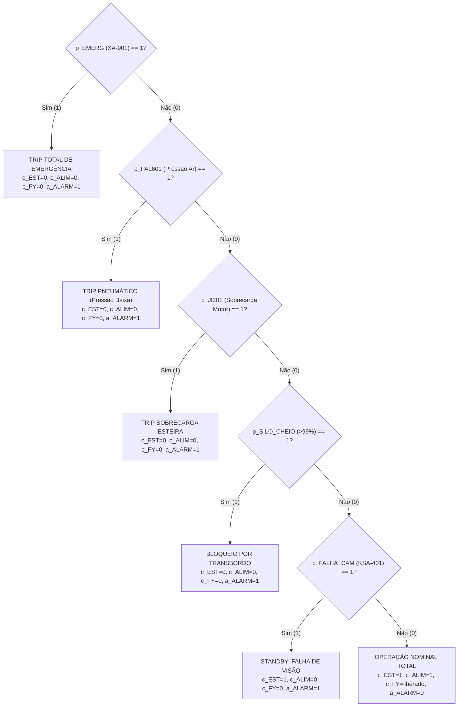
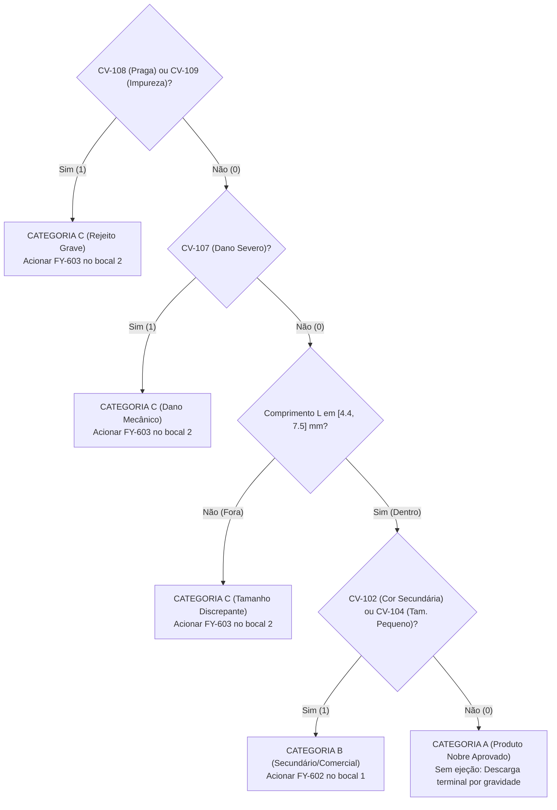

# Aplicações de Árvores Binárias na Planta de Classificação Óptica de Grãos

---

| Especificação Técnica | Detalhes |
| :--- | :--- |
| **Unidade Operacional** | Linha de Seleção, Pesagem Dinâmica e Classificação Óptica de Grãos & Historiador SCADA-Core |
| **Identificação do Projeto** | SCADA-Core Automática — GRUPO 4 |
| **Domínio de Engenharia** | Automação Industrial, Segurança Funcional (IEC 61508 / IEC 62061 / NR-12), Visão Computacional e Matemática Discreta |
| **Estruturas de Dados** | Árvores Binárias de Decisão (BDT para SIS e Classificação Óptica) e Árvores AVL com Agregação por Faixa |
| **Status do Documento** | Aprovado para Implementação em Controladores Lógicos Programáveis (CLP) e Servidor SCADA |

---

## 1. Árvore Binária de Decisão (BDT) — Sistema Instrumentado de Segurança (SIS)

### 1.1 Contextualização da Engenharia de Processos
A planta industrial do **Grupo 4** opera a seleção e classificação contínua de grãos de arroz em alta velocidade. O processo integra o funil dosador (`FN-101`), o acionamento da esteira transportadora (`EST-201`), a mesa de pesagem contínua (`BAL-301`), o túnel de inspeção óptica por visão computacional (`VIS-401`), duas estações de desvio por ejeção pneumática ultrarrápida (`FY-602` para Categoria B e `FY-603` para Categoria C) e a bateria de silos coletores (`SILO-701`, `SILO-702` e `SILO-703`).

A esteira opera com velocidade nominal de $v = 2{,}0\text{ m/s}$, processando fluxos de dezenas de milhares de grãos por minuto. Nesse ambiente de alta cadência, qualquer anomalia operacional — como queda súbita na pressão de ar comprimido (`PAL-601`), sobrecarga elétrica no motor de tração (`JI-201`), falha de comunicação da câmera industrial (`KSA-401`), transbordo de silos (`p_SILO_CHEIO`) ou acionamento de parada de emergência (`XA-901`) — exige intervenção de segurança determinística.

A ocorrência de uma queda de pressão pneumática abaixo de $6\text{ bar}$, por exemplo, inviabiliza o disparo instantâneo dos bocais de ejeção, provocando contaminação em massa do silo de produto nobre (Categoria A) por grãos defeituosos e impurezas da Categoria C. Para mitigar esses riscos com nível de integridade de segurança funcional **SIL-2 / PL-d**, implementa-se no firmware do CLP uma **Árvore Binária de Decisão (BDT — *Binary Decision Tree*)** com avaliação por curto-circuito.

### 1.2 Formalização Matemática da BDT de Segurança
A árvore de decisão de segurança é modelada como uma arborescência direcionada enraizada $T_{\text{SIS}} = (V, E)$, em que:

* $V = V_{\text{interno}} \cup V_{\text{folha}}$ é o conjunto finito de vértices:
  * $V_{\text{interno}}$ contém predicados lógicos booleanos derivados das tags dos instrumentos da norma ISA-5.1.
  * $V_{\text{folha}}$ contém os vetores de comando seguro enviados aos atuadores físicos:
    $$\mathbf{y}_{\text{safe}} = [c_{\text{EST}}, \; c_{\text{ALIM}}, \; c_{\text{FY602}}, \; c_{\text{FY603}}, \; a_{\text{ALARM}}]$$
* $E \subset V \times V$ representa as transições de avaliação $\{1 = \text{Condição de Falha Verdadeira}, \; 0 = \text{Conformidade / Normal}\}$.

### 1.3 Topologia da Árvore de Intertravamento (Mermaid)



### 1.4 Mapeamento Determinístico dos Instrumentos ISA-5.1

A tabela abaixo especifica o percurso hierárquico ordenado por severidade de risco de processo:

| Nível ($h$) | Nó de Decisão | Tag ISA-5.1 | Condição Lógica Booleana | Atuação nos Atuadores $[c_{\text{EST}}, c_{\text{ALIM}}, c_{\text{FY}}, a_{\text{ALARM}}]$ | Ação e Estado Funcional |
| :---: | :---: | :---: | :---: | :---: | :--- |
| **0 (Raiz)** | `XA-901` | Botoeira de Emergência | $p_{\text{EMERG}} = 1 \implies \text{Pressionada}$ | $[0, 0, 0, 1]$ | Desenergização Imediata Total |
| **1** | `PAL-601` | Pressostato Pneumático | $p_{\text{PAL601}} = 1 \implies P_{\text{ar}} < 6\text{ bar}$ | $[0, 0, 0, 1]$ | Trip por Falha de Suprimento Pneumático |
| **2** | `JI-201` | Relé de Sobrecarga | $p_{\text{JI201}} = 1 \implies I_{\text{motor}} \ge I_{\text{trip}}$ | $[0, 0, 0, 1]$ | Trip por Sobrecarga Mecânica da Esteira |
| **3** | Silos A/B/C | Sensores `LIT-701/702/703` | $p_{\text{SILO\_CHEIO}} = 1 \implies \text{Nível} \ge 99\%$ | $[0, 0, 0, 1]$ | Parada Anti-Transbordo de Silo |
| **4** | `KSA-401` | Câmera Industrial / IA | $p_{\text{FALHA\_CAM}} = 1 \implies \neg p_{\text{KSA401}}$ | $[1, 0, 0, 1]$ | Bloqueio de Carga e Purga da Esteira |
| **5 (Folha)** | Estado Seguro | Todos em conformidade | $p_{\text{EMERG}} = \dots = p_{\text{CAM}} = 0$ | $[1, 1, 1, 0]$ | Planta em Operação Normal |

### 1.5 Análise de Complexidade e Tempo Real
* **Garantia de Determinismo:** Como a árvore possui altura máxima fixa $h = 5$, o tempo de varredura (*scan time*) no CLP é limitado superiormente por $O(h) = O(5) = O(1)$.
* **Latência de Intertravamento:** A execução do ramo consome menos de $50\,\mu\text{s}$ no ciclo de controle, assegurando tempo total de reação da linha inferior a $10\text{ ms}$, em estrita conformidade com a norma IEC 62061.

---

## 2. Árvore Binária de Decisão para Classificação Óptica de Grãos

> [!IMPORTANT]
> **Inovação Técnica do Projeto (Grupo 4): Classificação em Tempo Real no Túnel Óptico**
> 
> Além da árvore de segurança (SIS), implementou-se uma segunda Árvore Binária de Decisão dedicada ao **algoritmo de segregação instantânea de grãos**. Em sistemas de alta velocidade, a IA do túnel `VIS-401` extrai parâmetros morfológicos e colorimétricos (`CV-101` a `CV-109`). A categorização deve ocorrer em menos de $2\text{ ms}$ — intervalo físico entre a captura da imagem pela câmera e a chegada do grão ao primeiro bocal de ejeção.

### 2.1 Topologia da BDT de Classificação de Grãos (Mermaid)



### 2.2 Formalização das Regras de Seleção
A classificação particiona o universo de grãos inspecionados em três classes mutuamente exclusivas com base nos predicados ISA-5.1:

1. **Categoria C (Rejeito / Descarte - Silo 703):**
   $$p_{\text{C}} \equiv p_{\text{CV108}} \lor p_{\text{CV109}} \lor p_{\text{CV107}} \lor \neg(4{,}4\text{ mm} \le L \le 7{,}5\text{ mm})$$
2. **Categoria B (Secundário / Comercial - Silo 702):**
   $$p_{\text{B}} \equiv \neg p_{\text{C}} \land (p_{\text{CV102}} \lor p_{\text{CV104}} \lor p_{\text{CV106}})$$
3. **Categoria A (Nobre Aprovado - Silo 701):**
   $$p_{\text{A}} \equiv \neg p_{\text{C}} \land \neg p_{\text{B}} \equiv p_{\text{CV101}} \land p_{\text{CV103}} \land p_{\text{CV105}} \land \neg p_{\text{CV107}} \land \neg p_{\text{CV108}} \land \neg p_{\text{CV109}}$$

A execução em árvore binária reduz o número de comparações de 9 (avaliação linear exaustiva) para no máximo **3 comparações condicionais por grão**, garantindo latência de decisão inferior a $150\,\mu\text{s}$.

---

## 3. Árvore Binária de Busca Auto-Balanceada (AVL) — Historiador SCADA-Core

### 3.1 Necessidade de Indexação Temporal no SCADA
O subsistema historiador da planta do Grupo 4 armazena em memória as amostras de telemetria contínua recebidas da balança dinâmica (`BAL-301`), do inversor de frequência da esteira (`EST-201`), da central pneumática (`CP-601`) e dos contadores de seleção. Uma estrutura sequencial (como uma lista ou vetor não indexado) possui tempo de busca linear $O(N)$, inviabilizando consultas interativas na tela de tendências da IHM quando o banco atinge centenas de milhares de registros.

Para garantir consultas pontuais e em janelas temporais em tempo logarítmico estrito $O(\log_2 N)$, os dados são organizados em uma **Árvore Binária de Busca Auto-Balanceada (AVL)** indexada pelo *timestamp* UNIX em milissegundos ($\tau \in \mathbb{N}$).

### 3.2 Estrutura do Nó na Memória Principal
Cada nó $n$ da Árvore AVL do historiador é estruturado como:

$$n = \Big\langle \tau, \; BF, \; \text{Ponteiro}_{\text{Esq}}, \; \text{Ponteiro}_{\text{Dir}}, \; \mathbf{D}(\tau) \Big\rangle$$

Onde a carga útil telemetrada $\mathbf{D}(\tau)$ contém o vetor de grandezas físicas e contadores de produção:

$$\mathbf{D}(\tau) = \left[ P_{\text{PT-601}}\text{ (bar)}, \; I_{\text{JI-201}}\text{ (A)}, \; W_{\text{WT-301}}\text{ (g)}, \; Q_{\text{FT-301}}\text{ (kg/h)}, \; v_{\text{ST-201}}\text{ (m/s)}, \; N_A, \; N_B, \; N_C \right]$$

### 3.3 Rigor Matemático e Fator de Balanceamento ($BF$)
Para qualquer nó $n \in V$, sendo $h(T_{\text{esq}})$ e $h(T_{\text{dir}})$ as alturas de suas subárvores esquerda e direita, o Fator de Balanceamento $BF(n)$ satisfaz estritamente o invariante AVL:

$$BF(n) = h(T_{\text{dir}}) - h(T_{\text{esq}}) \in \{-1, \; 0, \; +1\}$$

Se após uma inserção de telemetria ocorrer $|BF(n)| > 1$, o restabelecimento do equilíbrio ocorre em $O(1)$ por meio de uma das quatro rotações fundamentais:
* **Rotação Simples à Esquerda (RR):** Quando $BF(n) = +2$ e $BF(\text{filho}_{\text{dir}}) \ge 0$.
* **Rotação Simples à Direita (LL):** Quando $BF(n) = -2$ e $BF(\text{filho}_{\text{esq}}) \le 0$.
* **Rotação Dupla Direita-Esquerda (RL):** Quando $BF(n) = +2$ e $BF(\text{filho}_{\text{dir}}) < 0$.
* **Rotação Dupla Esquerda-Direita (LR):** Quando $BF(n) = -2$ e $BF(\text{filho}_{\text{esq}}) > 0$.

```
    Rotação Simples (LL):               Rotação Simples (RR):
          (Z)                                 (X)
         /   \                               /   \
       (X)    T3    ==>    (X)             T1    (Z)    ==>    (Z)
      /   \               /   \                 /   \         /   \
     T1   T2             T1   (Z)              T2   T3       (X)   T3
                             /   \                          /   \
                            T2   T3                        T1   T2
```

---

## 4. Mecanismo de Consulta por Intervalo com Agregação Online

> [!TIP]
> **Inovação Técnica do Projeto (Grupo 4): Range Queries com Métricas Estatísticas Instantâneas**
> 
> Durante a auditoria de qualidade ou após um alarme na esteira, o operador do SCADA seleciona uma janela histórica $[t_{\text{início}}, t_{\text{fim}}]$. O algoritmo executa um percurso em ordem (*In-Order Traversal*) restrito à faixa solicitada, recuperando os dados em ordem cronológica e calculando cumulativamente:
> 1. Taxa média de fluxo mássico ($\bar{Q}_{\text{FT-301}}$ em $\text{kg/h}$);
> 2. Massa líquida processada ($\Delta M$ em $\text{kg}$);
> 3. Rendimento percentual de produto nobre aprovado ($\eta_A = \frac{N_A}{N_A + N_B + N_C} \times 100\%$).

A complexidade temporal da consulta é dada por:

$$T_{\text{query}} = O(\log_2 N + K)$$

Onde $N$ é o total de amostras indexadas na árvore e $K$ é o número de amostras compreendidas dentro do intervalo temporal auditado ($K \ll N$).

---

## 5. Síntese e Comparativo de Aplicação na Planta

| Propriedade de Engenharia | BDT de Segurança (SIS) | BDT de Classificação Óptica | Árvore AVL (Historiador SCADA) |
| :--- | :--- | :--- | :--- |
| **Finalidade na Planta** | Intertravamento e Proteção NR-12 | Separação Pneumática Tripla | Auditoria e Gráficos de Tendência |
| **Chave de Decisão / Busca** | Predicados Booleanos de Risco | Descritores Geométricos/Cor | Timestamp UNIX ($\tau$) em ms |
| **Dinâmica Estrutural** | Estática (firmware do CLP) | Estática (pipeline de visão) | Altamente dinâmica ($100\text{ Hz}$) |
| **Tempo de Execução** | $O(1)$ determinístico ($\le 50\,\mu\text{s}$) | $O(1)$ determinístico ($\le 150\,\mu\text{s}$) | $O(\log_2 N)$ na busca e inserção |
| **Norma Associada** | IEC 61508 / IEC 62061 | Padrões MAPA (Classificação Arroz) | 21 CFR Part 11 / Auditoria RCA |

---

## 6. Referências Técnicas

1. ADELSON-VELSKY, G. M.; LANDIS, E. M. **An algorithm for the organization of information**. Proceedings of the USSR Academy of Sciences, v. 146, p. 263-266, 1962.
2. CORMEN, T. H. et al. **Algoritmos: Teoria e Prática**. 3. ed. Rio de Janeiro: Elsevier, 2012.
3. IEC 62061:2021. **Safety of machinery - Functional safety of safety-related control systems**. International Electrotechnical Commission, Geneva, 2021.
4. MAPA. **Instrução Normativa nº 6/2009 — Regulamento Técnico do Arroz**. Ministério da Agricultura, Pecuária e Abastecimento, Brasília, 2009.
