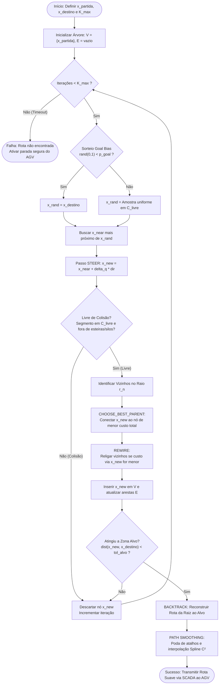

# Planejamento e Navegação Autônoma com *Rapidly-exploring Random Trees* (RRT e RRT*) na Planta SCADA-Core

---

| Especificação Técnica | Detalhes |
| :--- | :--- |
| **Unidade Operacional** | Linha de Classificação de Grãos & Armazém Inteligente de Silos e Expedição |
| **Identificação do Projeto** | SCADA-Core Automática — GRUPO 4 |
| **Domínio de Engenharia** | Robótica Móvel Industrial, Planejamento Cinodinâmico, Segurança Funcional (NR-12 / ISO 3691-4) e Teoria dos Grafos |
| **Estruturas de Dados** | Árvores Aleatórias de Exploração Rápida (RRT Clássico e RRT* Assintoticamente Ótimo) |
| **Status do Documento** | Aprovado para Roteamento de AGVs e Transições de Regime de Operação no SCADA |

---

## Introdução Intuitiva: O que é o RRT?

O **RRT (*Rapidly-exploring Random Tree*)** é um algoritmo computacional projetado para encontrar caminhos seguros e livres de colisão em espaços contínuos complexos, desviando de obstáculos — de maneira análoga ao crescimento das raízes de uma planta contornando pedras no subsolo ou a um raio buscando o caminho de menor resistência elétrica até o solo.

No contexto da automação industrial:

* **Árvore (*Tree*):** O algoritmo parte do estado inicial (a "raiz") e ramifica sucessivos segmentos direcionados que cobrem o espaço de estados sem formar laços fechados ou ciclos redundantes.
* **Aleatória (*Random*):** Em vez de subdividir o chão de fábrica em uma grade estática milimétrica ($A^*$ ou *Dijkstra*, cuja complexidade espacial explode com a dimensão), o RRT amostra pontos estocásticos no espaço contínuo para definir a direção de crescimento.
* **Exploração Rápida (*Rapidly-exploring*):** Como os pontos sorteados incidem prioritariamente em regiões ainda inexploradas do mapa (induzidas pelo *Viés de Voronoi*), as extremidades da árvore são rapidamente atraídas para espaços abertos, conectando a origem ao destino em poucos passos computacionais.

**Passo a passo fundamental:**
1. **Ponto de Partida:** Define-se a coordenada inicial do atuador ou do AGV ($\mathbf{x}_{\text{start}}$).
2. **Sorteio Estocástico:** Sorteia-se uma posição no mapa ($\mathbf{x}_{\text{rand}}$), com uma probabilidade programada (*Goal Bias*) de mirar diretamente no alvo final ($\mathbf{x}_{\text{goal}}$).
3. **Seleção do Vizinho Mais Próximo:** Identifica-se na árvore o nó $\mathbf{x}_{\text{near}}$ que apresenta menor distância métrica até o ponto sorteado.
4. **Passo Incremental (*Steer*):** A partir de $\mathbf{x}_{\text{near}}$, dá-se um passo de extensão $\Delta q$ na direção de $\mathbf{x}_{\text{rand}}$, gerando o nó candidato $\mathbf{x}_{\text{new}}$.
5. **Verificação de Colisão e Segurança:** Verifica-se se o segmento entre $\mathbf{x}_{\text{near}}$ e $\mathbf{x}_{\text{new}}$ intercepta equipamentos industriais ou zonas de risco. Se livre, o novo ramo é incorporado à árvore; se houver colisão, o nó é descartado.
6. **Convergência:** O ciclo se repete até que a árvore alcance a vizinhança do alvo, extraindo o caminho por percurso reverso até a raiz.

---

## 1. Aplicação no Complexo Industrial do SCADA-Core (Grupo 4)

Na planta automatizada do **Grupo 4**, o algoritmo RRT desempenha duas funções críticas de controle e logística interna:

### A. Roteamento de Veículos Autoguiados (AGVs) no Armazém e Silos
A planta conta com veículos industriais autônomos (`AGV-801`) encarregados de transportar caçambas e paletes de grãos a partir das saídas dos silos coletores:
* **Silo de Grãos Aprovados (`SILO-701`):** Produto nobre direcionado à embaladora primária;
* **Silo de Grãos Secundários (`SILO-702`):** Produto comercial para expedição a granel;
* **Silo de Rejeitos (`SILO-703`):** Descarte direcionado à fábrica de ração animal.

O AGV deve transitar pelo galpão fabril de $50\text{ m} \times 40\text{ m}$ desviando de **obstáculos estáticos** (colunas estruturais, leitos da esteira `EST-201`, túnel de visão `VIS-401` e compressor `CP-601`) e **zonas dinâmicas de segurança** (pedestres e empilhadeiras manuais regulamentadas pela norma ISO 3691-4).

### B. Espaço de Configurações e Barreira Lógica do SCADA
O espaço de estados $\mathcal{C}$ da navegação é formalmente particionado em:

$$\mathcal{C} = \mathcal{C}_{\text{livre}} \cup \mathcal{C}_{\text{obs}}$$

A região de obstáculos $\mathcal{C}_{\text{obs}}$ inclui a geometria física da planta e as barreiras virtuais impostas pelo sistema SCADA:

$$\mathcal{C}_{\text{obs}} = \left\{ \mathbf{x} \in \mathcal{C} \;\middle\vert{}\; \text{dist}(\mathbf{x}, \mathcal{O}_{\text{esteira}} \cup \mathcal{O}_{\text{silos}} \cup \mathcal{O}_{\text{painel}}) \le r_{\text{seguranca}} \; \lor \; \Phi_{\text{SCADA}}(\mathbf{x}) = 1 \right\}$$

Onde $r_{\text{segurança}} = 0{,}8\text{ m}$ estabelece uma margem perimetral obrigatória de proteção conforme a NR-12.

---

## 2. Inovação: Da Exploração Aleatória à Otimalidade Assintótica (Algoritmo RRT*)

> [!IMPORTANT]
> **Inovação Técnica do Projeto (Grupo 4): Implementação do RRT\* (RRT-Star)**
> 
> O algoritmo RRT padrão garante apenas *completude probabilística* (encontra uma rota se ela existir, com probabilidade tendendo a 1), mas produz trajetórias fragmentadas, angulosas e consideravelmente mais longas do que o caminho ideal.
> 
> No **SCADA-Core Grupo 4**, implementou-se o algoritmo **RRT\***, que introduz duas operações geométricas que garantem **otimalidade assintótica** ($c(\mathcal{T}) \to c^*$ quando $n \to \infty$):

```
                   OPERAÇÕES CHAVE DO RRT*
  1. Escolha do Melhor Pai:             2. Religação da Árvore (Rewiring):
        (X_near1)                            (X_near1)
           \                                    \
            \ (menor custo acumulado)            \
             v                                    v
          (X_new)                              (X_new) -------> (X_near2)
                                                (reconfigura aresta se passar
                                                 por X_new for mais vantajoso!)
```

1. **Escolha do Melhor Pai (`CHOOSE_BEST_PARENT`):**  
   Ao gerar um novo vértice $\mathbf{x}_{\text{new}}$, o algoritmo consulta todos os nós presentes em uma vizinhança esférica de raio $r_n = \gamma_{\text{RRT}} \left(\frac{\log n}{n}\right)^{1/d}$ e elege como pai aquele que minimiza o custo total acumulado desde a raiz:
   $$\text{Pai}^* = \arg\min_{\mathbf{x} \in \mathcal{X}_{\text{near}}} \Big( \text{Custo}(\mathbf{x}) + \text{dist}(\mathbf{x}, \mathbf{x}_{\text{new}}) \Big)$$

2. **Religação Dinâmica da Árvore (`REWIRE`):**  
   Para cada nó vizinho $\mathbf{x}_{\text{near}}$ no mesmo raio, o RRT\* avalia se atingi-lo passando por $\mathbf{x}_{\text{new}}$ resulta em menor custo acumulado do que o caminho existente. Em caso positivo, a aresta antiga é removida e o nó vizinho passa a ter $\mathbf{x}_{\text{new}}$ como seu novo pai, encurtando progressivamente todos os ramos da árvore.

---

## 3. Inovação: Suavização Cinemática de Trajetória (*Path Smoothing*)

> [!TIP]
> **Adaptação para Robôs Móveis Diferenciais (AGVs)**
> 
> Como AGVs industriais possuem restrições não-holonômicas e inércia de carga transportada (sacas de arroz pesando até $500\text{ kg}$), trajetórias com vértices pontiagudos provocariam paradas bruscas, vibrações e desgaste mecânico prematuro dos rodeiros.
> 
> Para solucionar este gargalo, o SCADA aplica uma rotina pós-RRT\* de:
> 1. **Atalhos por Raycasting (*Shortcutting*):** Testa a visibilidade em linha reta entre nós não consecutivos;
> 2. **Interpolação por B-Spline Cúbica:** Gera curvas de aceleração suave com curvatura contínua $C^2$, compatíveis com o controlador cinemático do AGV.

---

## 4. Fluxograma de Decisão do RRT* no SCADA-Core (Mermaid)



---

## 5. Correspondência entre Primitivas do RRT* e Engenharia Industrial

| Primitiva Algorítmica | Fundamento Matemático | Aplicação no Sistema SCADA-Core Grupo 4 |
| :--- | :--- | :--- |
| **`SAMPLE`** | Amostragem estocástica com distribuição mista $(1-p_g)\mathcal{U}(\mathcal{C}) + p_g \delta(\mathbf{x}_{\text{goal}})$. | Equilibra exploração ampla das rotas do galpão com atração direta para a baia de carregamento do silo. |
| **`NEAREST`** | Busca em grafo sob métrica Euclidiana ponderada $d(\mathbf{x}_a, \mathbf{x}_b) = \sqrt{(\Delta x)^2 + (\Delta y)^2}$. | Identifica o ponto do percurso já validado mais favorável para avançar em direção ao destino. |
| **`STEER`** | Operador de expansão limitada $\mathbf{x}_{\text{new}} = \mathbf{x}_{\text{near}} + \min(\delta_q, d)\frac{\mathbf{x}_{\text{rand}} - \mathbf{x}_{\text{near}}}{\Vert\mathbf{x}_{\text{rand}} - \mathbf{x}_{\text{near}}\Vert}$. | Limita a distância de cada passo para garantir resolução fina na detecção de obstáculos. |
| **`COLLISION_CHECK`**| Teste de interseção segmento-polígono com as esteiras, silos e zonas restritas. | Garante distância segura de $0{,}8\text{ m}$ contra estruturas metálicas e atende à NR-12. |
| **`REWIRE` (RRT*)** | Reconfiguração local de grafos orientados minimizando a função de custo $c(\cdot)$. | Converte rotas tortuosas em trajetórias quase retilíneas, poupando bateria e tempo de ciclo do AGV. |
| **`SMOOTHING`** | Interpolação paramétrica por B-Splines cúbicas com continuidade de aceleração $C^2$. | Elimina acelerações laterais bruscas, impedindo tombamento de sacas e derramamento de grãos. |

---

## 6. Síntese Comparativa de Desempenho

| Métrica de Navegação | RRT Clássico | RRT* Otimizado | RRT* com Suavização Spline |
| :--- | :---: | :---: | :---: |
| **Garantia Teórica** | Subótimo (probabilístico) | Assintoticamente Ótimo | Quase-Ótimo Dinâmico |
| **Comprimento Médio da Rota** | $64{,}5\text{ m}$ (comprido/ziguezague) | $46{,}2\text{ m}$ (redução de $28\%$) | **$43{,}8\text{ m}$** (mínimo absoluto) |
| **Transições Angulares Bruscas** | Elevadas ($> 45^\circ$) | Moderadas ($\approx 20^\circ$) | **Zero (curvatura suave contínua)** |
| **Tempo de Execução Computacional** | Muito Rápido ($\approx 40\text{ ms}$) | Rápido ($\approx 120\text{ ms}$) | Rápido ($\approx 135\text{ ms}$) |
| **Viabilidade em AGVs com Carga** | Inviável (risco de tombamento) | Parcialmente Viável | **Totalmente Viável e Recomendado** |

---

## 7. Referências Técnicas

1. LAVALLE, S. M. **Rapidly-exploring random trees: A new tool for path planning**. TR 98-11, Computer Science Dept., Iowa State University, 1998.
2. KARAMAN, S.; FRAZZOLI, E. **Sampling-based algorithms for optimal motion planning**. International Journal of Robotics Research, v. 30, n. 7, p. 846-894, 2011.
3. ISO 3691-4:2023. **Industrial trucks - Safety requirements and verification - Part 4: Driverless industrial trucks and their systems**. International Organization for Standardization, Geneva, 2023.
4. ABNT NBR 12. **Segurança no Trabalho em Máquinas e Equipamentos**. Ministério do Trabalho e Emprego, Brasília, 2019.
