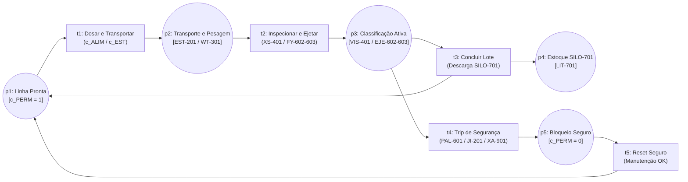
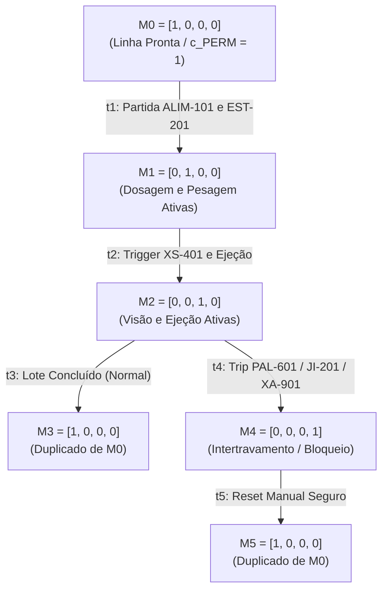

# Aula 24: Modelagem e Análise Formal com Redes de Petri — Árvore de Atingibilidade e Árvore de Cobertura

**Projeto:** SCADA-Core Automática — GRUPO 4  
**Unidade Fabril:** Linha Automatizada de Seleção, Pesagem Dinâmica e Classificação Óptica de Grãos com Separação Pneumática Tripla (Arroz)  
**Referência Normativa:** ISA-5.1, IEC 61131-3 & Teoria de Sistemas a Eventos Discretos (Redes de Petri)  

---

## 1. Introdução Didática: Por que Redes de Petri na Planta de Classificação de Grãos?

Na planta industrial do **Grupo 4**, o processamento de grãos de arroz ocorre em regime contínuo/semicontínuo de alta velocidade, combinando subsistemas **concorrentes, assíncronos e sujeitos a restrições físicas rígidas**:
* **Recepção e Dosagem:** Funil `FN-101` monitorado por `LIT-101` (`p_NB101`, `p_NA101`, `p_NC101`) e alimentador vibratório `ALIM-101` (`c_ALIM`);
* **Transporte, Pesagem e Inspeção Óptica:** Esteira `EST-201` (`c_EST`, encoder `ST-201`, sobrecarga `JI-201`), célula de carga `BAL-301` (`WT-301`/`FT-301`) e túnel de visão `VIS-401` (`XS-401`, `KSA-401`, classificadores `KXA-501/502/503`);
* **Ejeção Pneumática Sincronizada:** Compressor `CP-601` (`PT-601`, pressostato `PAL-601`) e atuadores ultrarrápidos `FY-602` (`ZSH-602`) e `FY-603` (`ZSH-601`);
* **Estocagem em Silos Finitos e Expedição Autônoma:** Silos coletores `SILO-701` (Cat. A - Nobre), `SILO-702` (Cat. B - Comercial) e `SILO-703` (Cat. C - Rejeito), monitorados por `LIT-701/702/703` e drenados para expedição pelo veículo autoguiado `AGV-801` (Aula 22).

Enquanto autômatos finitos sofrem com a **explosão combinatória de estados** ao modelar paralelismo (ex.: reabastecimento do funil, inspeção na esteira e retirada de caçambas nos silos ocorrendo ao mesmo tempo), as **Redes de Petri (RdP)** oferecem uma representação gráfica e algébrica compacta para verificar formalmente propriedades críticas antes mesmo de codificar a lógica no CLP:
* **Limitação (*Boundedness*):** Garante matematicamente que o funil `FN-101` e os silos coletores (`SILO-701/702/703`) nunca sofrerão transbordamento físico (*overflow*).
* **Ausência de Bloqueio (*Deadlock-freedom*):** Garante que o ciclo de dosagem, classificação, ejeção e retirada pelo `AGV-801` não travará indefinidamente aguardando um recurso compartilhado.
* **Segurança de Estados (*Safety* / Exclusão Mútua):** Comprova matematicamente que estados proibidos (ex.: classificação/ejeção pneumática ativa simultaneamente a um *trip* de subpressão `PAL-601`, sobrecarga `JI-201` ou emergência `XA-901`) são **inatingíveis**.

---

## 2. Definição Formal da Rede de Petri Marcada

Uma **Rede de Petri marcada** é definida formalmente pela quíntupla:

$$N = (P, T, Pre, Post, M_0)$$

Onde:
* **$P = \{p_1, p_2, \dots, p_m\}$:** Conjunto finito de **Lugares** (representam condições locais, estados de equipamentos ou disponibilidade de lotes/capacidade física).
* **$T = \{t_1, t_2, \dots, t_n\}$:** Conjunto finito de **Transições** ($P \cap T = \emptyset$, representam eventos ou ações de controle do CLP).
* **$Pre: P \times T \to \mathbb{N}$:** Matriz de pré-incidência (arcos que saem dos lugares para as transições; especifica os pré-requisitos para disparo).
* **$Post: P \times T \to \mathbb{N}$:** Matriz de pós-incidência (arcos que saem das transições para os lugares; especifica o efeito após o disparo).
* **$M_0: P \to \mathbb{N}$:** Vetor de **Marcação Inicial**, indicando o número de fichas (*tokens*) em cada lugar no instante $k = 0$.

### Regra de Habilitação e Equação Fundamental de Estado
Uma transição $t_j \in T$ está **habilitada** em uma marcação $M$ se, e somente se:

$$M(p_i) \ge Pre(p_i, t_j), \quad \forall p_i \in P$$

Ao disparar $t_j$, o sistema evolui para uma nova marcação $M'$ governada pela equação matricial:

$$M' = M + C \cdot \vec{e}_j$$

Onde $C = Post - Pre$ é a **Matriz de Incidência** ($m \times n$) e $\vec{e}_j$ é o vetor canônico correspondente à transição $t_j$.

---

## 3. Modelagem Aplicada à Planta de Classificação de Grãos (Grupo 4)

Para demonstrar rigorosamente tanto a **Árvore de Atingibilidade** (sistema limitado) quanto a **Árvore de Cobertura** (sistema ilimitado com símbolo $\omega$), modelamos o subsistema acoplado de **Dosagem (`FN-101`/`ALIM-101`), Inspeção e Ejeção (`EST-201`/`VIS-401`/`EJE-602/603`) e Acúmulo no Silo Coletor (`SILO-701`)**.

### 3.1. Mapeamento dos Lugares ($P$) e Transições ($T$)

| Símbolo | Descrição Física na Planta de Grãos (Grupo 4) | Interpretação das Fichas (*Tokens*) |
| :---: | :--- | :--- |
| **$p_1$** | Linha em *Standby* / Pronta para Operação (`c_PERM = 1`) | $1$ ficha = esteira `EST-201` livre, câmera `KSA-401` pronta e ar comprimido `PT-601` OK. |
| **$p_2$** | Dosagem e Transporte na Esteira (`ALIM-101` + `EST-201` + `BAL-301`) | $1$ ficha = lote dosado no funil `FN-101` em deslocamento e pesagem contínua (`WT-301`/`FT-301`). |
| **$p_3$** | Inspeção Óptica e Ejeção Pneumática Ativa (`VIS-401` + `FY-602/603`) | $1$ ficha = grãos sob câmera (`XS-401`) com disparo sincronizado via encoder `ST-201`. |
| **$p_4$** | Silo Coletor de Grãos Classificados (`SILO-701` — Cat. A) | $k$ fichas = lotes de grãos nobres acumulados aguardando retirada pelo `AGV-801`. |
| **$p_5$** | Falha / Intertravamento de Segurança (`TRIP` / `c_PERM = 0`) | $1$ ficha = bloqueio físico acionado (`PAL-601` baixa pressão, `JI-201` sobrecarga ou `XA-901` emergência). |

| Símbolo | Evento / Ação de Controle no CLP | Pré-condições ($Pre$) | Pós-condições ($Post$) |
| :---: | :--- | :--- | :--- |
| **$t_1$** | **Iniciar Dosagem e Partida da Esteira** (`c_EST = 1`, `c_ALIM = 1`) | $p_1$ ($1$) | $p_2$ ($1$) |
| **$t_2$** | **Entrar na Zona Óptica e Acionar Ejeção** (`XS-401`, `FY-602/603`) | $p_2$ ($1$) | $p_3$ ($1$) |
| **$t_3$** | **Concluir Lote e Depositar no `SILO-701`** (Purga e retorno a *Standby*) | $p_3$ ($1$) | $p_1$ ($1$), $p_4$ ($1$) |
| **$t_4$** | **Disparar Intertravamento Crítico (`TRIP`)** (`PAL-601` / `JI-201` / `XA-901`) | $p_3$ ($1$) | $p_5$ ($1$) |
| **$t_5$** | **Reset Manual após Inspeção e Restabelecimento de `c_PERM`** | $p_5$ ($1$) | $p_1$ ($1$) |

### 3.2. Diagrama Estrutural da Rede de Petri da Planta



---

## 4. Parte A: Árvore de Atingibilidade (Subsistema Limitado)

Inicialmente, analisamos o **ciclo de controle e intertravamento da linha de classificação** considerando os lugares $\{p_1, p_2, p_3, p_5\}$ (antes de acoplar o acúmulo irrestrito de lotes no silo $p_4$).

* **Marcação Inicial:** $M_0 = [1, 0, 0, 0]^T$ (Linha pronta em *Standby*, sem lote na esteira, sem ejeção ativa, sem falha).

### 4.1. Construção Passo a Passo
1. **Nó Raiz $M_0 = [1, 0, 0, 0]^T$:**
   * Apenas $t_1$ está habilitada ($M_0(p_1) = 1 \ge 1$).
   * Disparando $t_1$: $M_1 = [0, 1, 0, 0]^T$ (*Nó Novo* — Dosagem e pesagem em curso).
2. **Nó $M_1 = [0, 1, 0, 0]^T$:**
   * Apenas $t_2$ está habilitada.
   * Disparando $t_2$: $M_2 = [0, 0, 1, 0]^T$ (*Nó Novo* — Inspeção óptica e ejeção pneumática ativas).
3. **Nó $M_2 = [0, 0, 1, 0]^T$ (Conflito Estrutural / Ramificação):**
   * Duas transições estão habilitadas simultaneamente: **$t_3$** (conclusão nominal do lote) e **$t_4$** (ocorrência de falha crítica: `PAL-601`, `JI-201` ou `XA-901`).
   * Disparando $t_3$: $M_3 = [1, 0, 0, 0]^T = M_0$ (**Nó Duplicado / Folha** — encerra o ramo).
   * Disparando $t_4$: $M_4 = [0, 0, 0, 1]^T$ (*Nó Novo* — Sistema travado em estado seguro de *Trip*).
4. **Nó $M_4 = [0, 0, 0, 1]^T$:**
   * Apenas $t_5$ (*Reset* após normalização dos sensores) está habilitada.
   * Disparando $t_5$: $M_5 = [1, 0, 0, 0]^T = M_0$ (**Nó Duplicado / Folha**).



### 4.2. Diagnóstico de Engenharia pela Árvore de Atingibilidade
* **Finitude e $1$-Limitação (*Safeness*):** O conjunto de marcações atingíveis $R(N, M_0) = \{M_0, M_1, M_2, M_4\}$ é finito e $1$-limitado. Matematicamente, nunca ocorrerá sobreposição de dois lotes simultâneos na janela da câmera `VIS-401` (prevenindo *sobrealimentação*, conforme Seção 4.1 do `README.md`).
* **Vivacidade (*Liveness*) e Ausência de *Deadlocks*:** Não há estados terminais sem saída. Mesmo após um *trip* crítico ($M_4$), existe um caminho determinístico de recuperação segura ($t_5 \to M_0$).
* **Exclusão Mútua (Invariante de Segurança):** Em todo estado atingível vale $M(p_1) + M(p_2) + M(p_3) + M(p_5) = 1$. Logo, é **impossível** atingir uma marcação com $M(p_3) = 1$ e $M(p_5) = 1$ simultaneamente — provando formalmente a integridade do permissivo `c_PERM` da Etapa 1.

---

## 5. Parte B: Árvore de Cobertura (Sistemas Ilimitados e o Símbolo $\omega$)

Acoplamos agora o **Silo Coletor `SILO-701` ($p_4$)** sem modelar a retirada de caçambas/expedição pelo `AGV-801` nem o bloqueio de nível crítico `p_NC701`. A cada ciclo completo $t_1 \to t_2 \to t_3$, um novo lote de arroz aprovado é acumulado em $p_4$:

$$[1,0,0,0,0] \xrightarrow{t_1 t_2 t_3} [1,0,0,1,0] \xrightarrow{t_1 t_2 t_3} [1,0,0,2,0] \xrightarrow{t_1 t_2 t_3} \dots \to \infty$$

A Árvore de Atingibilidade convencional torna-se **infinita**. Para garantir terminação finita e detectar lugares que crescem sem limite, aplicamos o **Algoritmo de Karp-Miller (Árvore de Cobertura)**.

> **Regra de Aceleração ($\omega$):**  
> Se, ao gerar uma nova marcação $M'$, existir um nó ancestral $M$ no caminho da raiz até $M'$ tal que $M' \ge M$ (componente a componente) e $M' \neq M$, substitui-se $M'(p_i)$ pelo símbolo **$\omega$** em toda coordenada $i$ onde $M'(p_i) > M(p_i)$, obedecendo à aritmética estendida $\omega \pm c = \omega$ e $\omega > n, \forall n \in \mathbb{N}$.

### 5.1. Evolução do Vetor Completo $M = [p_1, p_2, p_3, p_4, p_5]^T$
1. $M_0 = [1, 0, 0, 0, 0]^T$
2. $M_0 \xrightarrow{t_1} M_1 = [0, 1, 0, 0, 0]^T$
3. $M_1 \xrightarrow{t_2} M_2 = [0, 0, 1, 0, 0]^T$
4. $M_2 \xrightarrow{t_3} M'_3 = [1, 0, 0, 1, 0]^T$:
   * Comparando com o ancestral $M_0 = [1, 0, 0, 0, 0]^T$: temos $M'_3 \ge M_0$ e estritamente maior em $p_4$ ($1 > 0$).
   * **Aceleração Karp-Miller:** $M_3 = [1, 0, 0, \omega, 0]^T$.
5. Expandindo $M_3 = [1, 0, 0, \omega, 0]^T$:
   * $M_3 \xrightarrow{t_1} M_4 = [0, 1, 0, \omega, 0]^T \xrightarrow{t_2} M_5 = [0, 0, 1, \omega, 0]^T$;
   * $M_5 \xrightarrow{t_3} M_6 = [1, 0, 0, \omega + 1, 0]^T = [1, 0, 0, \omega, 0]^T = M_3$ (**Nó Duplicado**);
   * $M_5 \xrightarrow{t_4} M_7 = [0, 0, 0, \omega, 1]^T \xrightarrow{t_5} M_8 = [1, 0, 0, \omega, 0]^T = M_3$ (**Nó Duplicado**).

```
                 M0 = [1, 0, 0, 0, 0]
                          | t1
                 M1 = [0, 1, 0, 0, 0]
                          | t2
                 M2 = [0, 0, 1, 0, 0]
                    /            \
                t3 /              \ t4
                  v                v
     M3 = [1, 0, 0, w, 0]     M_err = [0, 0, 0, 0, 1]
          | t1                     | t5
     M4 = [0, 1, 0, w, 0]     M_rec = [1, 0, 0, 0, 0] (Duplicado de M0)
          | t2
     M5 = [0, 0, 1, w, 0]
        /            \
    t3 /              \ t4
      v                v
[1, 0, 0, w, 0]   [0, 0, 0, w, 1]
 (Duplicado M3)        | t5
                       v
                  [1, 0, 0, w, 0]
                   (Duplicado M3)
```

---

## 6. Correção de Engenharia: Síntese de Controle por Lugar Complementar (Invariante-P)

A detecção do símbolo **$\omega$** em $p_4$ (`SILO-701`) — e, no modelo completo do notebook, também no funil `FN-101` quando há reabastecimento contínuo — representa um **alerta formal de projeto**: *se a expedição pelo `AGV-801` parar ou operar abaixo da vazão mássica `FT-301`, o silo sofrerá transbordamento físico*.

### Solução Estrutural via Lugar Complementar ($p_{\text{vaga}}$)
Para impor uma capacidade física finita $K_{\max}$ ao `SILO-701` (ex.: $K_{\max} = 2$ lotes no notebook) e eliminar o símbolo $\omega$, adicionamos:
1. Um **Lugar Complementar** $p_6$ (*Espaço Livre no `SILO-701`*, monitorado continuamente por `LIT-701` antes do limiar crítico `p_NC701`), com marcação inicial $M_0(p_6) = K_{\max}$;
2. Uma **Transição de Drenagem/Expedição** $t_6$ (*Abertura de `XV-701` e coleta do lote pelo `AGV-801`* — Aula 22).

Com essa síntese, o sistema passa a obedecer rigorosamente ao **Invariante-P de Conservação de Capacidade**:

$$M(p_{\mathrm{SILO-701}}) + M(p_{\mathrm{SILO-701\_VAGA}}) = K_{\max}, \quad \forall M \in R(N, M_0)$$

Assim, a conclusão/descarga de novos lotes só fica habilitada quando houver espaço físico livre ($M(p_{\mathrm{vaga}}) \ge 1$, equivalente a $\neg p_{\mathrm{NC701}} \land \neg p_{\text{SILO\_CHEIO}}$), restaurando uma **Árvore de Atingibilidade finita, livre de $\omega$, sem *deadlocks*, reversível e viva (*L4-Live*)**.

---

## 7. Análise de Viabilidade no Processo do Grupo 4 e Integração Multietapas

A aplicação de Redes de Petri e das Árvores de Atingibilidade/Cobertura é **plenamente viável e de alto impacto técnico** na nossa planta de classificação de grãos:

| Dimensão de Viabilidade | Aplicação Direta no Projeto SCADA-Core (Grupo 4) | Benefício de Engenharia |
| :--- | :--- | :--- |
| **Segurança Funcional (Etapa 1)** | Valida dinamicamente as expressões booleanas `c_PERM`, `c_ALIM`, `c_FY602`, `c_FY603` e o ciclo *cascading cleanout* / `p_STANDBY`. | Prova matemática de exclusão mútua entre operação e estados de *trip* (`PAL-601`, `JI-201`, `XA-901`). |
| **Controle de Gargalos e Silos (Etapa 2)** | Converte o grafo estático de fluxo (`FN-101` $\to$ `SILO-701/702/703`) em modelo dinâmico de fichas (*tokens*). | Detecta *overflow* via símbolo $\omega$ antes da operação e dimensiona o intertravamento de `LIT-101` e `LIT-701/702/703`. |
| **Sincronização com Logística (Etapa 3)** | Integra o ritmo da linha de classificação com a janela de coleta do `AGV-801` (Aula 22 — RRT*) sobre a rede Ethernet redundante `RSTP` (Aula 23). | Garante que o sistema nunca entre em *deadlock* entre a esteira de alta velocidade e a retirada de caçambas nos silos. |
| **Custo Computacional no CLP** | A árvore de atingibilidade é verificada *offline* em projeto; no CLP, os invariantes-P viram simples comparações de nível e contadores ($O(1)$ por *scan*). | Viabilidade imediata em CLPs industriais comerciais sem sobrecarga de CPU ou memória. |

---

## 8. Resumo Comparativo e Entregável da Aula 24

| Critério | Árvore de Atingibilidade | Árvore de Cobertura (Karp-Miller) |
| :--- | :--- | :--- |
| **Aplicabilidade** | Apenas Redes de Petri **Limitadas** (*Bounded*). | **Qualquer** Rede de Petri (limitada ou ilimitada). |
| **Representação de Crescimento** | Exata (números naturais $\mathbb{N}$). | Aproximada via símbolo **$\omega$** para lugares ilimitados. |
| **Decidibilidade** | Decide todas as propriedades comportamentais exatas. | Decide limitação ($k$-*boundedness*), cobertura e risco de *overflow* ($\omega$). |
| **Uso na Planta de Grãos (Grupo 4)** | Validação formal de `c_PERM`, `FY-602/603`, exclusão mútua e ciclo com `AGV-801`. | Detecção de risco de transbordamento no funil `FN-101` e nos silos `SILO-701/702/703`. |

* **Entregável da Aula 24:** Notebook Python [`Aula 24 - Árvore de Atingibilidade e Cobertura em Redes de Petri - code.ipynb`](file:///c:/Users/Home/Desktop/Automatica/SCADA-Core_Automatica_GRUPO4/etapa-03-arvores/Aula%2024%20-%20%C3%81rvore%20de%20Atingibilidade%20e%20Cobertura%20em%20Redes%20de%20Petri%20-%20code.ipynb) com implementação matricial da Rede de Petri, Algoritmo de Karp-Miller, síntese por Lugar Complementar, auditoria automática de propriedades e plotagem do Grafo de Atingibilidade finito.
